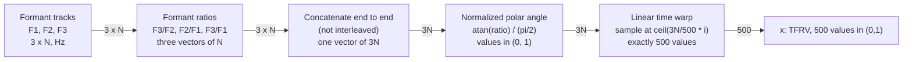
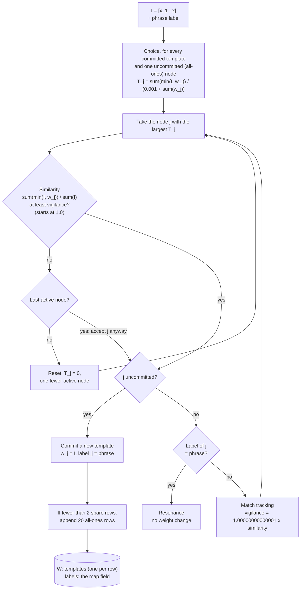
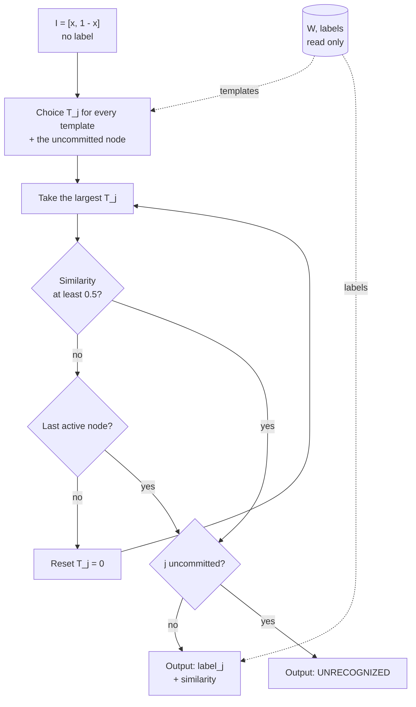
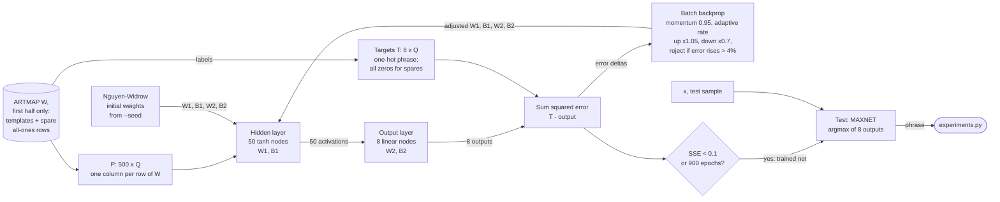

# The 1995 recognizer: functional components and I/O

**Status: for review, 2026-11-09.** These diagrams show the recognizer from the
speaker's voice to a recognized phrase. Every arrow is labelled with what
passes along it. They cover the 1995 system as the thesis describes it
(Chapter 5, Annexes C–G) and the Python port in
[`src/blindman/repro1995/`](../src/blindman/repro1995/) that reproduces
Chapter 6 ([PHASE0.md](PHASE0.md)).

**Legend:**

| Shape | Meaning |
| --- | --- |
| Circle | Outside the system: the speaker, the telephone network. This follows Figure 5.2 |
| Rectangle, solid border | A component ported to Python, with its file name |
| Rectangle, dashed grey border | 1995 hardware or MATLAB code that is **not** ported |
| Cylinder | Stored data |
| Red cylinder | Lost data: the WAV recordings and the spectrograms did not survive |

**The port starts at the formant files.** The raw audio and the spectrograms
are lost. The 2,547 formant files (`F*.MAT`) are the earliest data that
survives, so the Python port begins there. Porting the front end, `MAKESPEC.M`
and `FORMANT3.M`, is needed before new recordings can be used (STAGE2,
Phase 1).

---

## 1. End to end

```mermaid
flowchart TB
    SPK(("Speaker"))
    PSTN(("Public telephone<br/>network, 1994"))

    subgraph REC["Stage 1: sound recording (§5.2–5.4, Figure 5.2)"]
        MIC["Realistic Super Cardioid microphone<br/>in an egg-carton mic box"]
        TAPE["Tape deck<br/>metal-bias cassette, gain taped"]
        PICK["Telephone pickup<br/>at the far end of a local call"]
        CARD["Sound card + GoldWave 2.11<br/>486DX33 PC"]
        NOISE["Room-noise recording<br/>sampled several times"]
    end

    WAV[("WAV files<br/>WazWav 4:1, ARJ, 1.92 MB floppies<br/>LOST")]

    subgraph SIG["Stage 2: signal processing (§5.5)"]
        SPEC["MAKESPEC.M<br/>normalize amplitude by 2^15<br/>1 s chunks, SPECGRAM<br/>512-point Hanning, 50% overlap<br/>keep rows below 5000 Hz"]
    end

    SMAT[("S*.MAT spectrograms<br/>LOST")]

    subgraph FEX["Stage 3a: formant extraction (§5.6, FORMANT3.M)"]
        MASK["Noise mask<br/>max of noise spectrogram per row,<br/>subtracted, negatives set to 0"]
        STE["Silence removal<br/>drop slices with low<br/>short-term energy"]
        OCT["Octave gain, eq. 5.1<br/>10^(log2(row)/5)"]
        PEAK["Peak picking<br/>3 largest local maxima<br/>in 300–3300 Hz"]
        SCREEN["Formant screening<br/>reject slice if F1 > 1200 Hz<br/>or fewer than 3 peaks"]
    end

    FMAT[("F*.MAT formant files<br/>Formant: 3 x N, Hz<br/>2,547 files, SURVIVE<br/>thesis-1995/data/")]

    subgraph PY["Python port: src/blindman/repro1995/"]
        LOAD["data.py<br/>load, number sessions,<br/>SD and SI splits"]
        FEAT["features.py<br/>Stage 3b: representation (§5.7)"]
        PRES["fuzzy_artmap.py: complement()<br/>presentation layer"]
        TRAIN["fuzzy_artmap.py: train()<br/>section 2"]
        TEST["fuzzy_artmap.py: predict()<br/>section 3"]
        BP["backprop.py<br/>benchmark, section 4"]
        EXP["experiments.py + __main__.py<br/>folds, confusion matrices, scoring"]
    end

    TGT[("chapter6_targets.json<br/>the thesis's printed tables")]
    OUT[("Results table, results/*.json,<br/>CI score gate")]

    SPK -- "acoustic speech" --> MIC
    MIC -- "analog, on-line route" --> CARD
    MIC -- "analog" --> TAPE
    TAPE -- "analog, batch route" --> CARD
    TAPE -- "analog, played into a local call" --> PSTN
    PSTN -- "analog, band-limited by the line" --> PICK
    PICK -- "analog + pickup noise" --> CARD
    NOISE -- "analog room noise" --> CARD
    CARD -- "PCM mono 16-bit<br/>microphone 22050 Hz, telephone 8000 Hz" --> WAV
    WAV -- "WAV samples" --> SPEC
    SPEC -- "magnitude spectrogram<br/>rows = frequency, columns = time" --> SMAT
    SMAT -- "spectrogram" --> MASK
    WAV -- "1 s of room noise" --> MASK
    MASK -- "noise-reduced spectrogram" --> STE
    STE -- "voiced slices only" --> OCT
    OCT -- "tilt-corrected spectrogram" --> PEAK
    PEAK -- "3 candidate formants per slice" --> SCREEN
    SCREEN -- "F1, F2, F3 tracks in Hz" --> FMAT

    FMAT -- "Formant 3 x N, WaveFile name" --> LOAD
    LOAD -- "Sample: speaker, date, phrase 2–9,<br/>session, formants" --> FEAT
    FEAT -- "x in [0,1]^500 (TFRV)<br/>or [0,1]^300 (BFRV)" --> PRES
    PRES -- "I = [x, 1 - x]<br/>length 1000 or 600" --> TRAIN
    PRES -- "I" --> TEST
    LOAD -- "phrase label<br/>training only" --> TRAIN
    TRAIN -- "W: one template per<br/>training sample, + labels" --> TEST
    TRAIN -- "W without its complement half,<br/>+ labels" --> BP
    FEAT -- "x, test samples" --> BP
    TEST -- "phrase or UNRECOGNIZED" --> EXP
    BP -- "phrase" --> EXP
    TGT -- "printed confusion matrices" --> EXP
    EXP -- "8 x 8 confusion matrix,<br/>rate, difference from thesis" --> OUT

    classDef lost fill:#fde8e8,stroke:#c0392b,color:#000
    classDef legacy stroke-dasharray:5 4,stroke:#888,fill:#f4f4f4,color:#000
    classDef survive fill:#e8f4e8,stroke:#2e7d32,color:#000
    class WAV,SMAT lost
    class MIC,TAPE,PICK,CARD,NOISE,SPEC,MASK,STE,OCT,PEAK,SCREEN legacy
    class FMAT survive
```

### Stage 3b: from formant tracks to the network's input

This is the normalization that makes every phrase the same length, whatever
its duration (`features.py`, §5.7.3–5.7.4):

BFRV is the same with two ratios, F3/F2 and F2/F1, warped to 300. No BFRV code
survives, so this path is reconstructed from §5.7.2.

---

## 2. Training: how the network learns a phrase

**For review: training adds templates but never adjusts weights.** In
textbook Fuzzy ARTMAP, a node that resonates is moved towards the input,
`w ← β(I ∧ w) + (1 − β)w`. FARTMAPT.M uses fast learning with no recoding
(§5.8.2), so a template is set once, equal to the input that created it, and
never changes. The thesis calls these templates **classification landmarks**.

At a training vigilance of 1.0, only an identical vector passes the vigilance
test against an existing template. Each training sample therefore becomes its
own landmark. A check on DY's first 80 microphone samples gave 80 templates.
In this configuration, Fuzzy ARTMAP training is template storage. The one
place that weights are adjusted to match an output layer is the backprop
benchmark (section 4).

The map field is FARTMAPT.M's simplification of ART-b (§5.8.1, Figure 5.21).
It is a list of labels, one per template, and match tracking consults it.

The thesis text says that memory grows by "10 new columns" (§5.8.1). The code
appends 20 rows (`W` has one template per row). The port follows the code.

---

## 3. Testing: matching to the closest template

- **What "closest" means here:** the template with the largest choice value
  `T_j`, among those whose similarity passes the testing vigilance of 0.5.
  `T_j` measures how much of the template the input covers, `|I ∧ w_j|`, and
  divides it by the template's size, `|w_j|`. It is not a Euclidean distance.
  This is the "nearest landmark" of §5.8.3.
- **Testing never learns.** `W` is read only, and there is no match tracking.
- **The last active node is accepted** whatever its similarity. This is how
  FARTMAPT.M is written. The uncommitted node is the last candidate, so when
  nothing passes vigilance the result is UNRECOGNIZED.
- Every test compares the input against every template. The thesis notes that
  this cost grows with memory (§5.8.3).

---

## 4. The backprop benchmark

The 1995 initial weights (`bpinit.mat`) and the trained network
(`bprtmapt.mat`) are lost, so the port draws Nguyen-Widrow weights from a
seed. Results vary by about ±1.1 points from seed to seed (PHASE0.md, note 5).

---

## 5. Component I/O

| Component | Input | Output | Source | Ported |
| --- | --- | --- | --- | --- |
| Microphone, mic box | Speech, acoustic | Analog voltage | §5.4 | Hardware |
| Tape deck | Analog | Analog: to the sound card (batch) or into a local call (telephone) | §5.4, Fig. 5.2 | Hardware |
| Telephone network + pickup | Analog | Band-limited analog with pickup noise | §5.4, §6.2.2 | Hardware |
| Sound card, GoldWave | Analog | WAV, PCM mono 16-bit, 22050 Hz (mic) or 8000 Hz (telephone) | §5.4, Annex A | No; audio is lost |
| `MAKESPEC.M` | WAV | Spectrogram `S*.MAT`, 512-point Hanning, 50% overlap, below 5000 Hz | §5.5, Annex C | No; Phase 1 |
| `FORMANT3.M` | Spectrogram + room-noise WAV | `F*.MAT`: `Formant` 3 x N in Hz, 300–3300 Hz | §5.6, Annex D | No; Phase 1 |
| `data.py` | `thesis-1995/data/{microphone,telephone}/` | `Sample` list; SD and SI splits | §6.2.1 | Yes |
| `features.py` | `Formant` 3 x N | TFRV in (0,1)^500, or BFRV in (0,1)^300 | §5.7, Annex E | Yes (BFRV reconstructed) |
| `FuzzyARTMAP.complement` | x | I = [x, 1 − x] | Annex E | Yes |
| `FuzzyARTMAP.train` | I + phrase | New template row in `W`, label appended | §5.8.1–5.8.2, Annex E | Yes |
| `FuzzyARTMAP.predict` | I | Phrase or UNRECOGNIZED, + similarity | §5.8.3, Annex E | Yes |
| `Backprop.fit_from_artmap` | `W`, labels, seed | W1, B1, W2, B2; epochs; SSE | Annex F | Yes (initial weights reconstructed) |
| `Backprop.predict` | x | Phrase | Annex G | Yes |
| `experiments.py` | Splits, a network, targets | Confusion matrix, rate, difference from the thesis | Chapter 6 | Yes |
| `__main__.py` | `--seed`, `--json` | Results table; JSON with an environment block | — | New |
