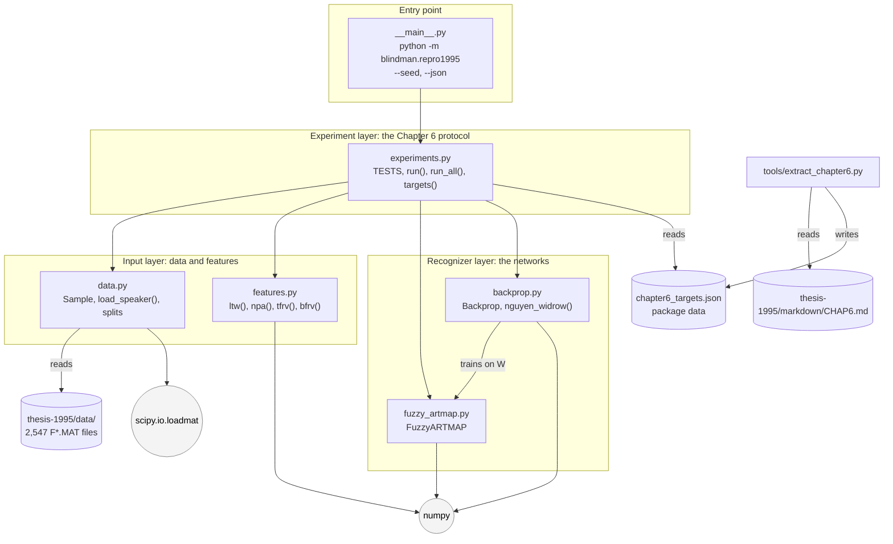
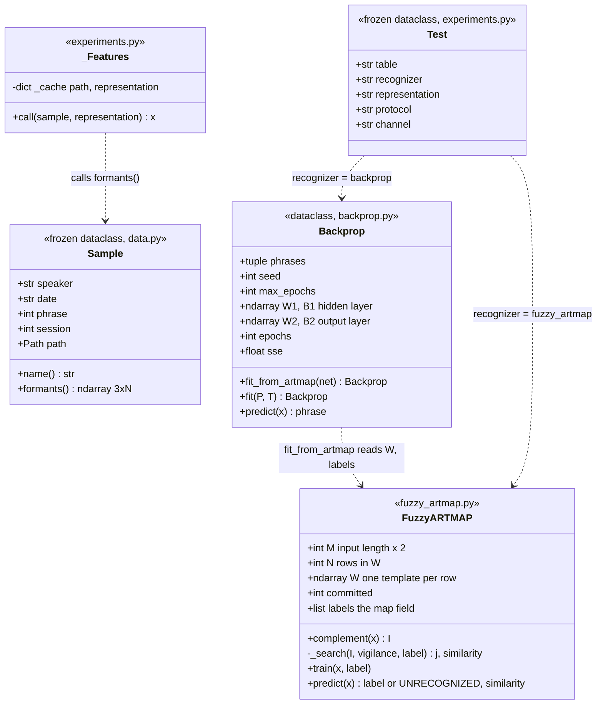
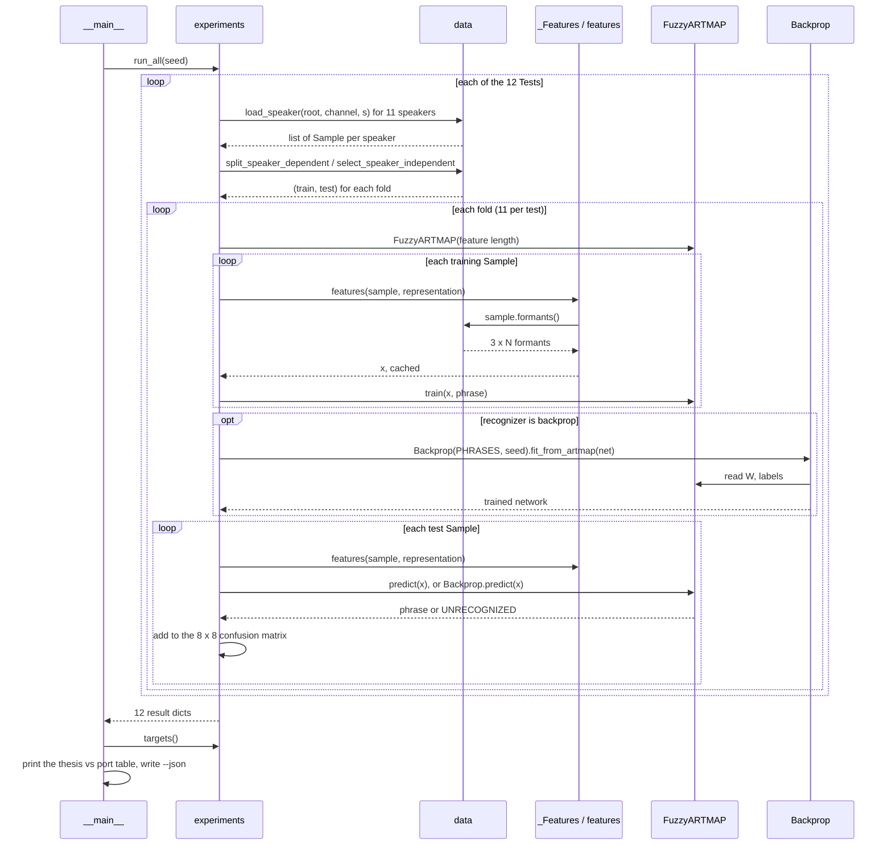
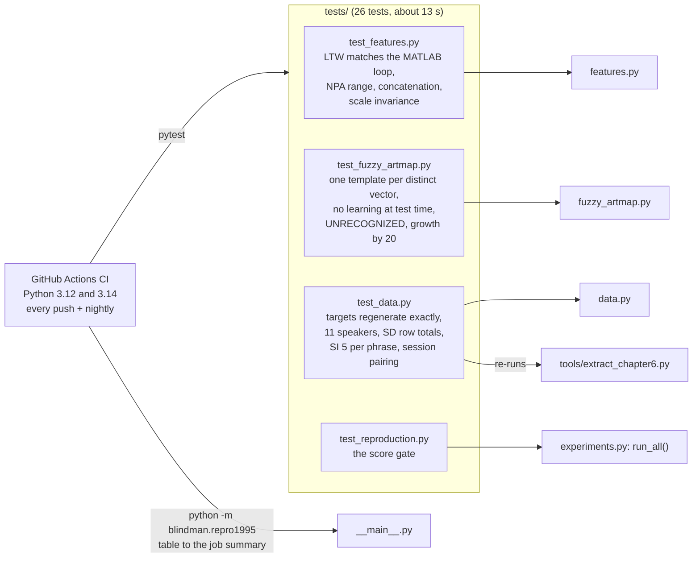

# The Python port: software design

**Status: for review, 2026-11-10.** This page shows how the Python port
in [`src/blindman/repro1995/`](../src/blindman/repro1995/) is built: the role of
each module and class, and how they depend on and call each other.
[COMPONENTS.md](COMPONENTS.md) shows the same system from the signal's point
of view, as a chain of processing stages with their inputs and outputs. This
page shows it from the code's point of view.

The port has six modules, one data file, four test files, one tool and one CI
workflow. It depends only on numpy and scipy.

---

## 1. Modules and their dependencies

An arrow means "imports" or "reads". The modules form a layered stack, with
no cycles:
- `data`, `features` and `fuzzy_artmap` know nothing of the experiments;
- `backprop` depends only on `fuzzy_artmap`, for the weight matrix it trains on;
- `experiments` is the only module that knows the Chapter 6 protocol;
- `__main__` is the only module that prints.

| Module | Role | Knows about |
| --- | --- | --- |
| `data.py` | Finds and loads a speaker's formant files. Groups them into recording sessions, pairs telephone sessions with microphone sessions, and builds the speaker-dependent (SD) and speaker-independent (SI) splits | File names, dates, sessions, phrases 2–9. Not features or networks |
| `features.py` | Turns a 3 x N formant track into a fixed-length vector in (0, 1): formant ratios, normalized polar angle, linear time warp | Arrays only |
| `fuzzy_artmap.py` | The 1995 Fuzzy ARTMAP network: complement coding, category choice, vigilance, match tracking, templates and their labels | Vectors and labels. Not files or the protocol |
| `backprop.py` | The benchmark network: 50 tanh, 8 linear, batch backpropagation with momentum. It builds its training set from a trained `FuzzyARTMAP`'s weights | `FuzzyARTMAP.W`, `labels`, `N`, `M` |
| `experiments.py` | The Chapter 6 protocol: the 12 tests, their folds, the training and test loop, confusion matrices. Caches features | Everything below it |
| `__main__.py` | The command line: runs every test, prints the comparison with the thesis, optionally writes JSON with the seed and environment | `experiments` only |
| `chapter6_targets.json` | The thesis's printed confusion matrices, for comparison | Generated by `tools/extract_chapter6.py`; never edited by hand |

---

## 2. Classes

- **`Sample`** is immutable and holds only where a recording is and what it
  is. It loads its formants when asked, so building a split costs nothing
  until features are needed.
- **`FuzzyARTMAP`** has state: `W` and `labels` grow as `train()` commits
  templates. `predict()` reads that state but never changes it.
- **`Backprop`** never sees the samples directly when it trains. Its training
  set is the ARTMAP weight matrix, as in BPMAPPER.M. That is why it depends on
  `FuzzyARTMAP` and is always created after one has been trained.
- **`Test`** is one row of the experiment table: which recognizer, which
  representation, which protocol, which channel.
- **`_Features`** is called like a function (`__call__`). It caches each feature vector by file and representation, so
  across all 12 tests a file is read at most once per representation. Without
  it, a full run would read each file once for every test that uses it.

---

## 3. One run, step by step

What happens for one test, for example Table 6.6-M (Fuzzy ARTMAP, TFRV, SI,
microphone):

A **fold** is one trained network:
- **SD:** one fold per speaker, trained on the first half of that speaker's
  samples and tested on the second half.
- **SI:** one fold per held-out speaker, trained on the other ten speakers'
  first 5 tokens per phrase and tested on the held-out speaker's.

Either way, a test trains 11 networks.

---

## 4. Tests and CI: how the port is checked

**The score gate**, `test_reproduction.py`, fails the build if any reproduced
result leaves its tolerance:

| Group | Tables | Must |
| --- | --- | --- |
| Exact | 6.4-M, 6.4-T, 6.6-M, 6.6-T | Match the printed confusion matrix cell for cell |
| Same total | 6.3-M, 6.5-M | Match the total, with only the known phrase-7 files moved (PHASE0.md, note 3) |
| Telephone SD | 6.3-T, 6.5-T | Stay within 1.0 point, on 615 samples instead of 624 |
| Backprop | 6.1, 6.2 | Stay within 4.0 points; the 1995 initial weights are lost |

---

## 5. Design choices worth reviewing

1. **The networks know nothing about files or the protocol.**
   `FuzzyARTMAP` and `Backprop` take vectors and labels only. New recordings,
   a new front end (a `FORMANT3.M` port) or a modern feature set can therefore
   be plugged in without touching the networks.
2. **Backprop is coupled to Fuzzy ARTMAP on purpose.** It trains on the ARTMAP
   weight matrix, including the spare all-ones rows, because BPMAPPER.M did.
   Training it directly on the samples would be a cleaner benchmark, but it
   would no longer reproduce Tables 6.1 and 6.2. If we keep both, the choice
   should be an option.
3. **Seeds and weights are not yet saved per fold.** `--json` records the
   seed and the environment, but not each fold's initial and trained
   backprop weights. That is agreed item 1 from the kickoff session, still to
   do.
4. **`predict()` return types differ:** `FuzzyARTMAP.predict` returns
   `(label, similarity)`, while `Backprop.predict` returns the label alone.
   `experiments.run` handles both. A shared recognizer interface, with
   `train` and `predict` returning the same shape, would make adding a third
   recognizer simpler.
