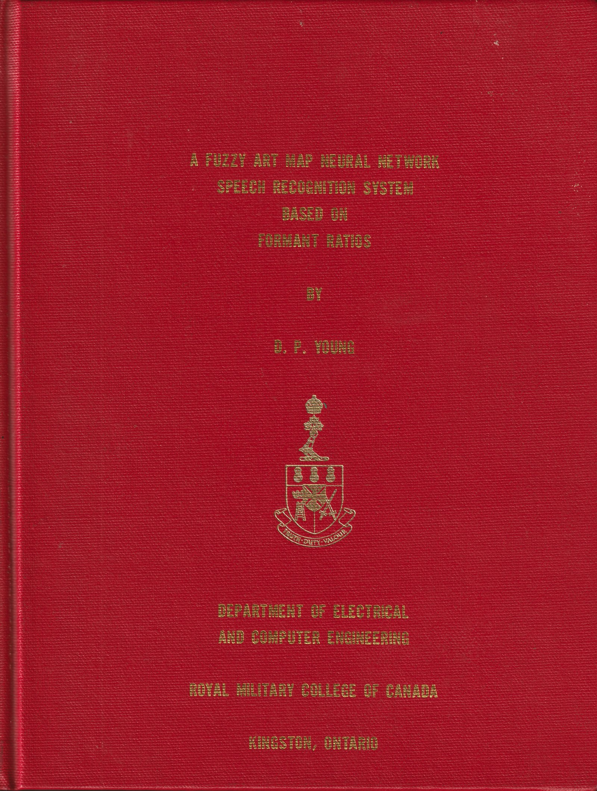

# A Fuzzy ART Map Neural Network Speech Recognition System Based on Formant Ratios

**Captain D.P. Young, CD, B.Sc., rrmc — Canadian Forces**
M.Eng. thesis, Department of Electrical and Computer Engineering,
Royal Military College of Canada, Kingston, Ontario — **May 1995**

> This thesis investigates the applicability of a Fuzzy ART (Adaptive Resonance Theory) Map
> artificial neural network to automatic speech recognition (ASR) over telephone-bandwidth
> channels (300–3300 Hz), using formant-ratio feature vectors extracted from spoken phrases.
> The system was tested on an eight-phrase, phonetically rich database recorded by fourteen
> speakers over four months, with both microphone and telephone recordings.

This repository preserves the thesis as it was submitted in 1995, recovered from the original
Microsoft Word 6.0 files (floppy disk → CD-ROM → portable hard drive) and converted to formats
readable today.

## Read it

| Format | Where | Notes |
|---|---|---|
| **PDF (whole thesis)** | [`Young-1995-FuzzyARTMAP-ASR-Thesis.pdf`](Young-1995-FuzzyARTMAP-ASR-Thesis.pdf) | 179 pages including the cover, bookmarked by chapter. Best for reading. |
| PDF per chapter | [`pdf/`](pdf/) | |
| Markdown (readable on GitHub) | [`markdown/`](markdown/) | Text, tables, equations and figures; annex code listings as code blocks. |
| Word (.docx) | [`docx/`](docx/) | Editable modern Word format. |
| **Original Word 6.0 files** | [`original/`](original/) | Byte-for-byte originals, last saved 3–15 May 1995. See [`CHECKSUMS.sha256`](CHECKSUMS.sha256). |

## Code and data

| | Where |
|---|---|
| **Source code**: the 1995 MATLAB 4.0 programs and demo scripts, plus the author's 2015 MATLAB R2015 refactor | [`code/`](code/) |
| **RMC Speech Database features**: 2,547 formant-track files (14 speakers, 8 phrases, microphone and telephone channels, Sept–Dec 1994) | [`data/`](data/) |

## Contents

| | Markdown | PDF |
|---|---|---|
| Front matter — title, abstract, contents | [CHAP0](markdown/CHAP0.md) | [pdf](pdf/CHAP0.pdf) |
| 1 — Introduction | [CHAP1](markdown/CHAP1.md) | [pdf](pdf/CHAP1.pdf) |
| 2 — Neural Network Overview | [CHAP2](markdown/CHAP2.md) | [pdf](pdf/CHAP2.pdf) |
| 3 — The Fuzzy ART Map ANN | [CHAP3](markdown/CHAP3.md) | [pdf](pdf/CHAP3.pdf) |
| 4 — Automatic Speech Recognition | [CHAP4](markdown/CHAP4.md) | [pdf](pdf/CHAP4.pdf) |
| 5 — A Fuzzy ART Map ASR System | [CHAP5](markdown/CHAP5.md) | [pdf](pdf/CHAP5.pdf) |
| 6 — Experimental Results | [CHAP6](markdown/CHAP6.md) | [pdf](pdf/CHAP6.pdf) |
| 7 — Concluding Remarks | [CHAP7](markdown/CHAP7.md) | [pdf](pdf/CHAP7.pdf) |
| References | [REFS](markdown/REFS.md) | [pdf](pdf/REFS.pdf) |
| Annex A — ASR System Hardware and Software | [ANNEXA](markdown/ANNEXA.md) | [pdf](pdf/ANNEXA.pdf) |
| Annex B — ASR demo script (Stdemo Player 1.5) | [ANNEXB](markdown/ANNEXB.md) | [pdf](pdf/ANNEXB.pdf) |
| Annex C — `MAKESPEC.M` (spectrogram) | [ANNEXC](markdown/ANNEXC.md) | [pdf](pdf/ANNEXC.pdf) |
| Annex D — `FORMANT3.M` (formant-ratio extraction) | [ANNEXD](markdown/ANNEXD.md) | [pdf](pdf/ANNEXD.pdf) |
| Annex E — `FARTMAPT.M` (Fuzzy ART Map network) | [ANNEXE](markdown/ANNEXE.md) | [pdf](pdf/ANNEXE.pdf) |
| Annex F — `BPMAPPER.M` (backprop benchmark, training) | [ANNEXF](markdown/ANNEXF.md) | [pdf](pdf/ANNEXF.pdf) |
| Annex G — `BPTESTER.M` (backprop benchmark, testing) | [ANNEXG](markdown/ANNEXG.md) | [pdf](pdf/ANNEXG.pdf) |

## About the recovery

See [`RECOVERY_NOTES.md`](RECOVERY_NOTES.md) for how the files were converted, what was
verified, and the known conversion defects.

## License

© D.P. Young 1995. Code is released under the **MIT License**. The thesis text, figures and
speech data are released under **CC BY 4.0**. See [`LICENSE`](../LICENSE).

The speech recordings were made with the help of staff and post-graduate students of the RMC
Department of Electrical and Computer Engineering, who volunteered their voices.
