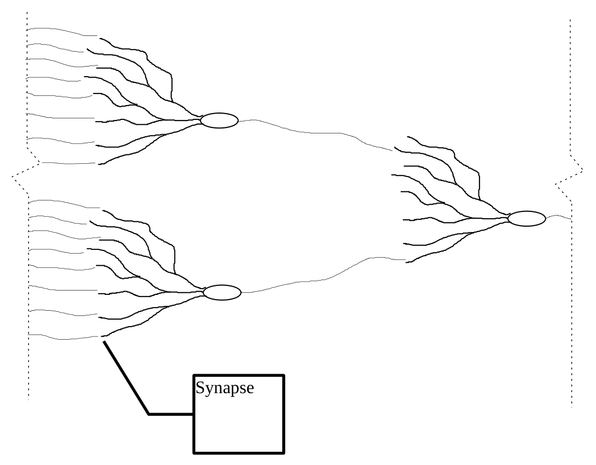
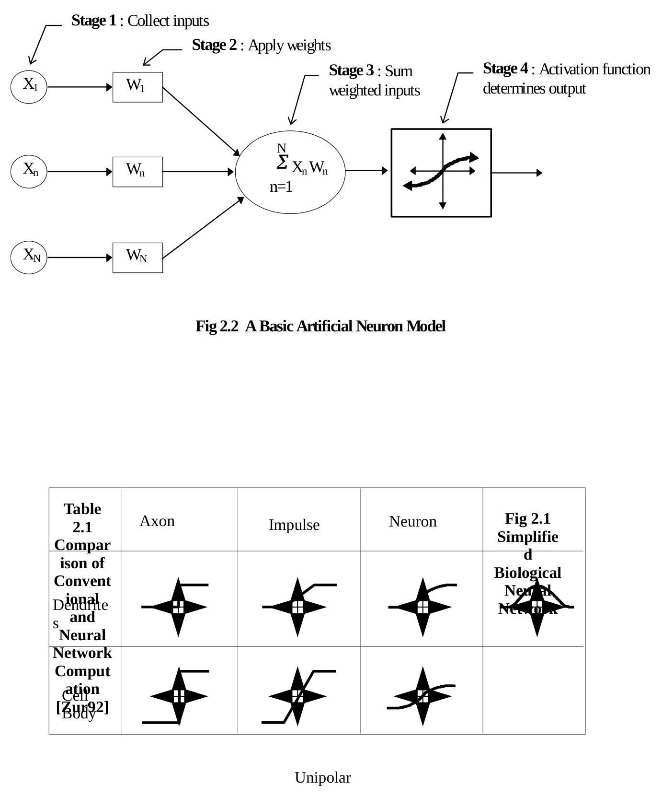
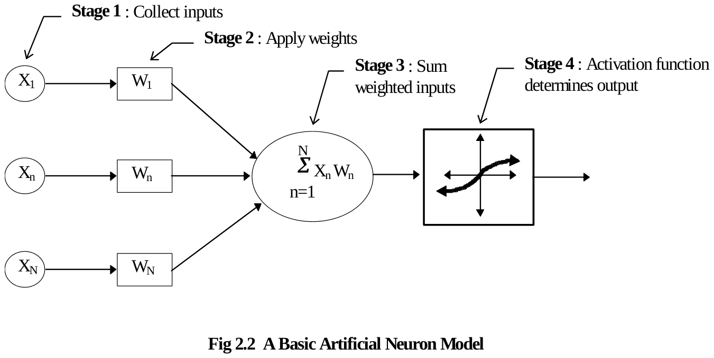
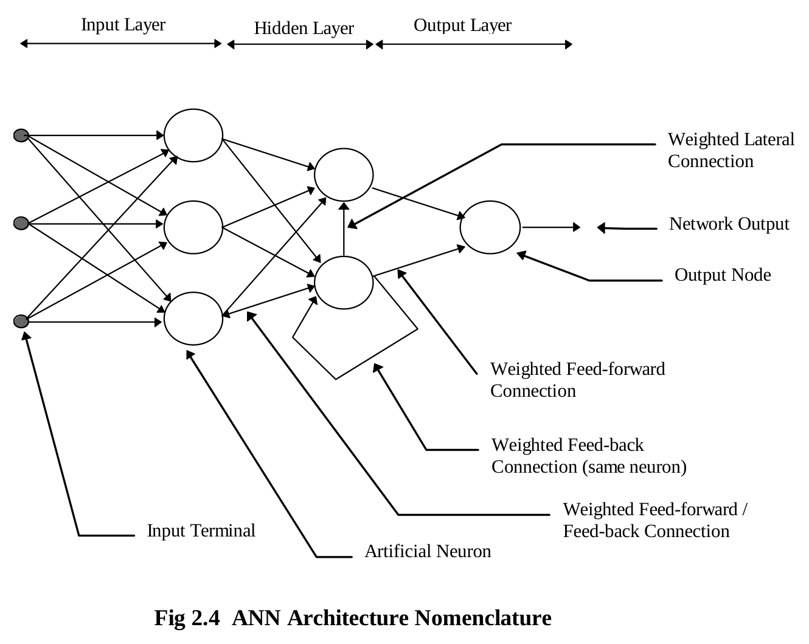
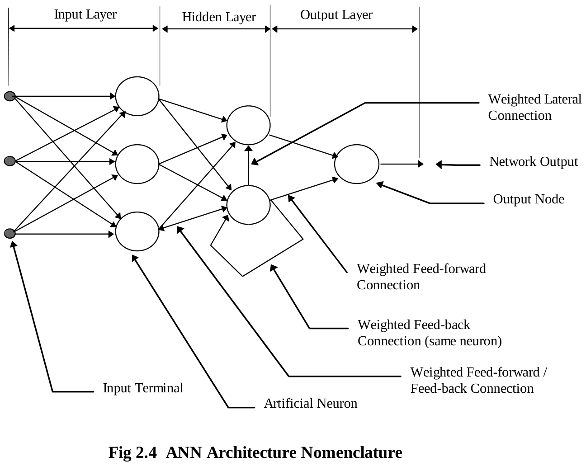

**CHAPTER TWO**

**NEURAL NETWORK OVERVIEW**

**2.1 Introduction**

It may seem strange that while computers excel at tasks that we find mentally challenging (such as large number calculations) they in turn fail at tasks that we find the easiest to do. To understand this distinction of abilities between the human brain and computers we must examine how these two systems differ.

The human brain consists of highly interconnected network of billions of simple processors called neurons as shown in the sketch in Figure 2.1 above. The neuron processes information as relatively slow electro-chemical pulses transmitted between neurons over synaptic connections. Each neuron may have many input connections that enable it to accept or “see” the output pulses of many other neurons simultaneously. It is this pattern of input pulses that triggers a neuron to transmit a pulse of its own \[Zur92\]. All neurons process and communicate information concurrently and in parallel with one another. Also, the brain can adjust its field of view on incoming data as well as detect patterns within this data allowing it to excel at tasks involving pattern recognition.

*Figure 2.1 (vector drawing recovered from rendered page; the conversion damaged its layout, see the PDF or the printed original)*

In contrast, conventional computers are controlled by a single complex processor called a **CPU (central processing unit)** operating in a segmented manner**.** The CPU processes information as relatively fast electrical pulses transmitted between other system components by way of a single fixed data channel called a data bus. Although the CPU can process information at a very high rate, it must retrieve and store this information in a sequentially. The heart of the CPU’s power lies in its ability to compare two numbers very rapidly; however, it must handle all of its data one element at a time. This makes it very inefficient for handling large amounts of data simultaneously (as required for pattern recognition) but very efficient at performing sequential calculations.

By designing networks simulating the computational capabilities of the human brain, engineers hope to construct systems capable of performing complex tasks with comparable efficiency. Such systems have been dubbed **ANNs (artificial neural networks)** as they attempt to model the most basic structure and dynamics of the brain. To take advantage of the parallel processing capability of ANNs, they must be built as hardware systems. Software simulations of ANNs are also attractive because they run (albeit slower) on conventional computers and their flexibility allows easier experimentation. This discussion is limited to the implementation of ANNs as software systems and refers to them as ANN programs (covered in section 2.2).

It should be mentioned to the novice that the study of artificial neural systems has many aliases in the literature. Some synonyms are neural networks, neurocomputing, network computation, parallel distributed processing, connectionism, self-organizing networks, layered adaptive systems and neuromorphic systems.

**2.2 ANN Programs**

A major difference between computers and ANNs is the programming paradigm used. Conventional computer programs consist of a collection of instruction sequences that are assembled by a programmer before the execution of the program and remain unchanged as the program executes. In contrast, ANN programs are able to alter their processing structure in response to the system input by storing and updating “memories” with learning algorithms that employ various theories about basic brain dynamics. ANN programs model a densely interconnected network containing cells of processing elements and interconnecting links. The processing elements are referred to as **nodes** or **artificial neurons** since they mimic the function of real neurons in the brain. The interconnecting links are referred to as **weights** since their numerical values affect the signal strength between the processing elements much like the synaptic bonds between real neurons. ANN programs model the structure and dynamics of a network that combine to dictate how the program acquires, stores, and uses learned knowledge. Thus, the “programmed” ANN model determines **how** input is learned, while the interaction with the system environment determines **what** input is learned. Table 2.1 below compares conventional computation to that of neural networks.

**2.3 The Artificial Neuron Model**

The operation of an artificial neuron can be visualized as a four stage process illustrated in figure 2.2. **Stage one** involves the collection of input elements to the neuron. The number of elements that comprise the total input and the source of each element is determined by the design layout of the connections within the network. Typically, the sources of inputs are the neural outputs of the preceding layer in the network, although the output from any neuron (including itself) in any layer may be used as an input source. **Stage two** involves adjusting the amplitude of each input element using a weighting function. This mimics the effect of the synaptic bond strength, which attenuates or amplifies signals transmitted between brain neurons. Typically the output of the weighting function is simply the product of the input element and a variable weight value. **Stage three** involves the summation of all the weighted input elements from stage two. This net value becomes the argument to the activation function used in **stage four** to determine the final output of the neuron. Typical activation functions are shown in figure 2.3. It is the non-linearity of the activation functions that give ANNs the ability of decision making \[Zur92\].

*Figure 2.2, Table 2.1 and Figure 2.3 (vector drawings recovered from rendered page; the conversion damaged its layout, see the PDF or the printed original)*

|  |  |  |
|----|----|----|
| **Task** | **Conventional Computation** | **Neural Network Computation** |
| **Problem Solving** | Algorithm formulation | Selection of architecture and definition of the set of representative examples |
| **Input Data** | Numerical form | Numerical, but also perceptual representation allowed |
| **Knowledge acquisition** | Programming | Training |
| **Knowledge retrieval** | Sequential computation | Recall in the form of collective processing |
| **Computation** | High-precision arithmetic | Low precision non-linear mapping |
| **Internal data** | Internal representation in control of the algorithm | Internal representation in control of input data |
| **Fixed or intermediate data storage** | ROM, RAM high-precision binary memories | Interconnecting weights of typically continuous values |

Incoming Axons from other Neurons

**2.4 Differentiating Between ANNs**

Different ANNs derive their unique computational abilities from the manner in which their artificial neurons are connected. Their distinctive structure is referred to as their **architecture** and it is the feature that characterizes them the most. ANNs also differ from one another in the manner in which they adapt their weights in response to input stimulus. Different learning rules control this **learning process** and govern how and when it occurs. The manner in which ANNs retrieve internally stored information is governed by their architecture and is described as their **recall process**.

**2.4.1 ANN Architecture**

Networks are typically organized into layers of neurons. The number of the layers classifies the ANN as single-layered, bi-layered, or multi-layered. The types of connective pathways between the neuron layers classify the ANN as feedforward, feedback or laterally connected. Figure 2.4 shows the naming conventions used to describe the various neuron layers and neuron connections.

*Figure 2.4 (vector drawing recovered from rendered page)*

**2.4.2 ANN Learning Process**

The behaviors of ANNs are determined by the values of the weights associated with the connections between their processing elements. The adaptation of ANN weights to produce a specific stimulus response behavior is herein referred to as the ANN learning process. The manner in which learning takes place is governed by learning rules that are said to perform in a supervised or unsupervised manner. **Supervised learning** is so denoted because the ANN adjusts its weights to produce a predefined output value (given by an external source) in response to a given input stimulus. **Unsupervised learning** does not provide a teacher’s solution and requires the ANN to discover it’s own relationships within the input data.

Supervised learning incorporates a set of training data in which network inputs are matched with the known desired outputs. The network weights are adjusted until the actual network output matches the desired network output within a desired error tolerance. The supervised adaptation of weights may be carried out one input/output pair at a time (**incremental training**), or it may be conducted using the complete training set in a single training step (**batch training**) without involving feedback information produced by the network itself.

Unsupervised learning combines the learning and recall modes. The network learns to recognize features in the input data by adjusting its weight values to produce a localized output in response to a given distribution of input patterns. This self-organizing capability holds great potential for producing a system capable of autonomously adapting to a task environment.

**2.4.3 ANN Recall Process**

When in recall mode, the network weights remain fixed and are not influenced by the system input. Previously viewed training input patterns produce the corresponding trained output pattern. Novel input patterns from a test data set produce an output that is a generalization of the training set.

The ANN recall process can be described as operating in one of two modes. The first is a **feedforward mode** in which the input stimulus is transformed by the connection weights as it is propagated forward across the network connections to produce an immediate output response. For a given input stimulus, the output response is temporally static and isolated, meaning that it does not change over time and it does not influence future network output. The second mode is a **recurrent mode** that is similar to the feedforward mode but uses feedback connections (see Fig 2.4) to augment the input stimulus. As a result the output response varies over time in response to the current input stimulus and the output response at the previous time instant. The granularity of this time instant depends on whether the network operates in the **discrete or continuous time domain** during recurrent recall mode.

**2.4.4 Major ANN Architectures**

Table 2.2 lists some of the major types of ANN architectures classified by their modes of learning and recall. This list is not exhaustive but is presented here to give the reader some idea of the variety of ANNs that currently exist. The Adaptive Resonance Theory networks, at the bottom of the list, will be dealt with specifically in chapter three since their understanding is central to this thesis. The multilayer feedforward ANN will be used as a benchmark for performance comparisons in chapter six and is described in section 2.5 below.

<table>
<colgroup>
<col style="width: 45%" />
<col style="width: 17%" />
<col style="width: 17%" />
<col style="width: 19%" />
</colgroup>
<tbody>
<tr>
<td style="text-align: center;"><strong>Network Architecture</strong></td>
<td><strong>Learning Mode</strong></td>
<td><strong>Recall Mode</strong></td>
<td><strong>Recall Time Domain</strong></td>
</tr>
<tr>
<td style="text-align: center;"><strong>Single-layer Network of Discrete and Continuous Perceptrons</strong></td>
<td>Supervised</td>
<td>Feedforward</td>
<td>----</td>
</tr>
<tr>
<td style="text-align: center;">
<strong>Multilayer Network of Discrete and Continuous Perceptrons</strong>

<strong>(e.g. Backpropagation ANN)</strong>
</td>
<td>Supervised</td>
<td>Feedforward</td>
<td>----</td>
</tr>
<tr>
<td style="text-align: center;"><strong>Gradient-type Network</strong></td>
<td>Supervised</td>
<td>Recurrent</td>
<td>Continuous</td>
</tr>
<tr>
<td style="text-align: center;"><strong>Linear Associative Memory</strong></td>
<td>Supervised</td>
<td>Feedforward</td>
<td>----</td>
</tr>
<tr>
<td style="text-align: center;"><strong>Autoassociative Memory</strong></td>
<td>Supervised</td>
<td>Recurrent</td>
<td>Discrete or Continuous</td>
</tr>
<tr>
<td style="text-align: center;"><strong>Bi-directional Associative Memory</strong></td>
<td>Supervised</td>
<td>Recurrent</td>
<td>Discrete or Continuous</td>
</tr>
<tr>
<td style="text-align: center;"><strong>Temporal Associative Memory</strong></td>
<td>Supervised</td>
<td>Recurrent</td>
<td>Discrete or Continuous</td>
</tr>
<tr>
<td style="text-align: center;"><strong>Hamming Network</strong></td>
<td>Supervised</td>
<td>Feedforward</td>
<td></td>
</tr>
<tr>
<td style="text-align: center;"><strong>MAXNET</strong></td>
<td>Supervised</td>
<td>Recurrent</td>
<td>Discrete or Continuous</td>
</tr>
<tr>
<td style="text-align: center;"><strong>Clustering Network</strong></td>
<td>Unsupervised</td>
<td>Feedforward</td>
<td>----</td>
</tr>
<tr>
<td style="text-align: center;"><strong>Counterpropagation Network</strong></td>
<td>Unsupervised / Supervised</td>
<td>Feedforward</td>
<td>----</td>
</tr>
<tr>
<td style="text-align: center;"><strong>Self-Organizing Neural Array</strong></td>
<td>Unsupervised</td>
<td>Feedforward</td>
<td>----</td>
</tr>
<tr>
<td style="text-align: center;"><strong>Adaptive Resonance Theory Networks</strong></td>
<td>Unsupervised / Supervised</td>
<td>Recurrent</td>
<td>Discrete or Continuous</td>
</tr>
</tbody>
</table>

**Table 2.2 Some Major ANNs Classified By Learning and Recall Modes \[Zur92\]**

**2.5 Backpropagation Learning in** **Multi-layer Feedforward ANNs**

Backpropagation is a supervised learning algorithm used to train multilayer feedforward ANNs. Although multi-layered ANNs have been around for more than 25 years, the lack of a successful training algorithm had limited their practical use. The development of the backpropagation algorithm has helped make multi-layer feedforward ANNs one of the most prevalent architectures in use today \[Zur92\]. The greatest strength of this ANN is that it can learn an input/output mapping of any complexity. Examples of tasks performed with this architecture include function approximation, handwritten character recognition, plant control, robot movement and trajectory generation, and speech recognition.

The backpropagation algorithm involves the repeated presentation of the training set and the incremental adjustment of all network weights between successive presentations. As each training vector is presented to the network inputs, the values of the network outputs are compared to the training vector’s target response to produce an error signal. This signal is then used to make the appropriate adjustments to the network weights to reduce the total network error (the particular of the backpropagation algorithm can be found in \[Zur92\]). In this manner, the network is programmed to map the training set to the target set with a given degree of accuracy. The number of training cycles required to reach the desired mapping accuracy varies depending on several factors. These include the relationship between the training and target set, the number and composition of the network layers, and the starting weights chosen to initialize the network.

The process of training the network can be visualized as a search for the global minimum on a multidimensional error surface. The direction of travel along this error surface is determined by the error signal mentioned above, while the distance traveled with each iteration is set by the programmer. Ideally, this distance or learning rate should match the complexity of the error surface “terrain”. A relatively large learning rate can jump over narrow valleys in mountainous terrain, while a relatively small learning rate will waste time slowly inching along relatively flat regions.

Training can be improved through the use of a momentum term and an adaptive learning rate. The momentum term prevents the learning algorithm from becoming trapped in shallow error mimima and thus improves its chances of discovering a solution that satisfies the desired accuracy goal. The adaptive learning rate varies the size of the incremental weight adjustments to match the rate at which the network output error is improving. For example, if the rate at which the network error is improving is positive , then the percentage of the error signal applied to amending the value of the weights is increased) . In chapter six we will see the implementation of these two learning aids in the ANN used to benchmark the performance of the Fuzzy ART Map ANN in the task of automatic speech recognition.

It should be noted that the mapping function performed by the backpropagation algorithm is based on the weight values of all network connections. This distributed method of knowledge storage contrasts the local method used by ART described in chapter three. Each method has certain advantages depending on the task being performed and will be discussed further in chapter six.

**2.6 Chapter Summary**

This chapter has given an overview of artificial neural networks (ANNs). They are

“... *computational systems, either in hardware or software, which mimic the computational abilities of biological systems by using large numbers of simple, interconnected artificial neurons. Artificial neurons are simple emulations of biological neurons; they take in information from sensor(s) or other artificial neurons, perform very simple operations on this data, and pass the results on to other artificial neurons. Neural networks operate by having their many artificial neurons process data in this manner. They use logical parallelism (for all neurons in the same layer) combined with serial operations (as information in one layer is transferred to neurons in another layer).*” \[Mar90\]. They represent “... *collective, non-algorithmic, low-precision, non-linear computing machines that learn during training from examples and are data-controlled.*” \[Zur92\].
