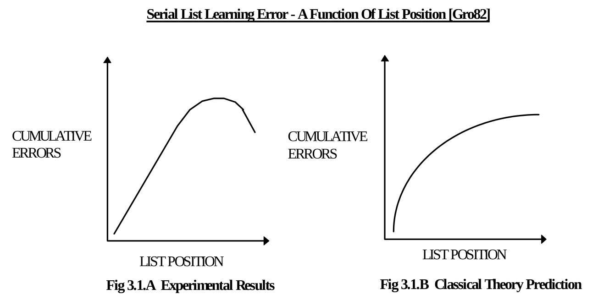
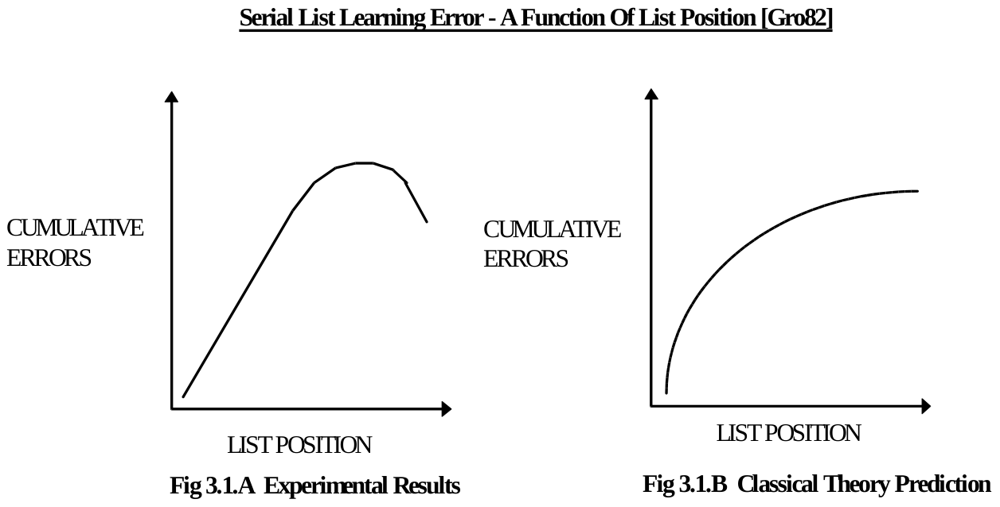
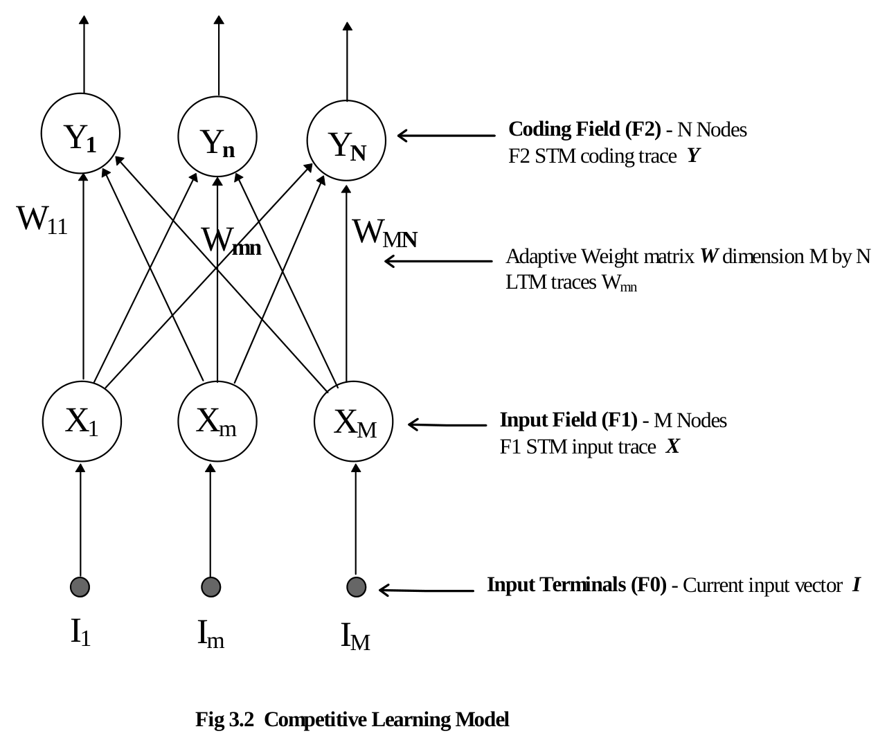
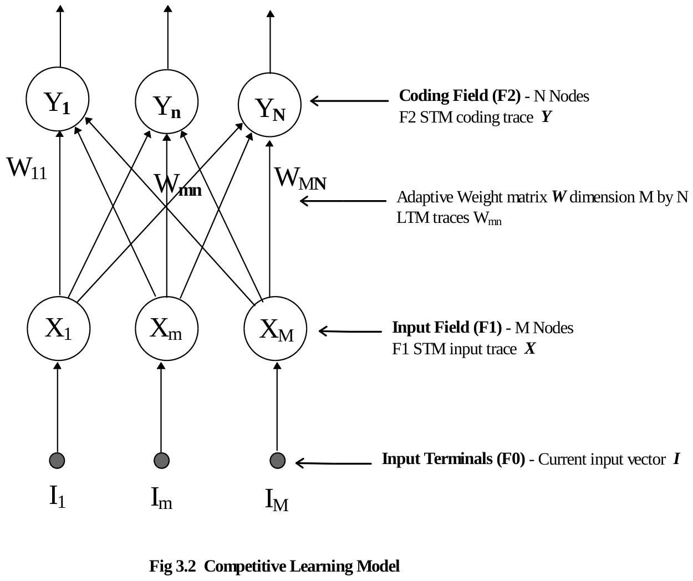
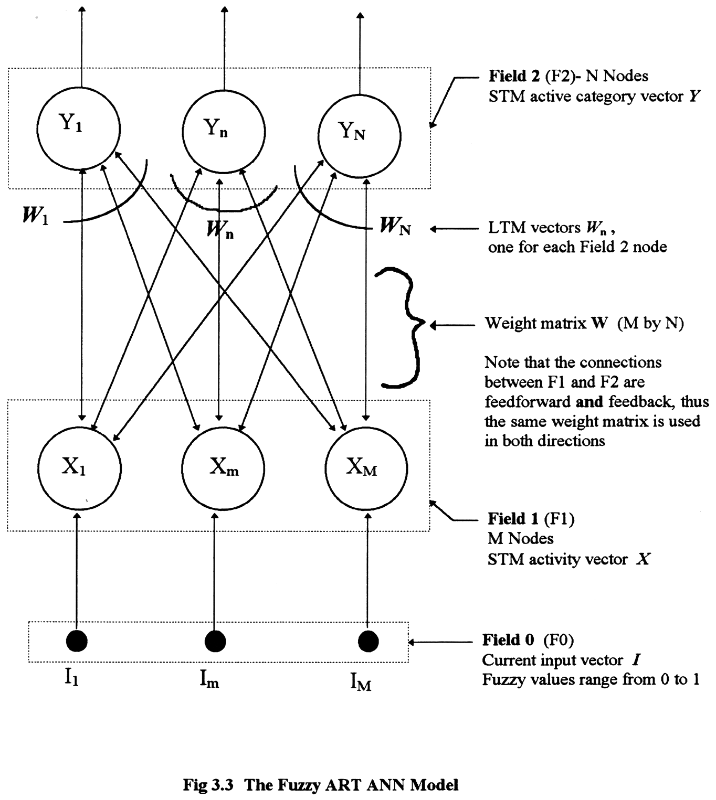
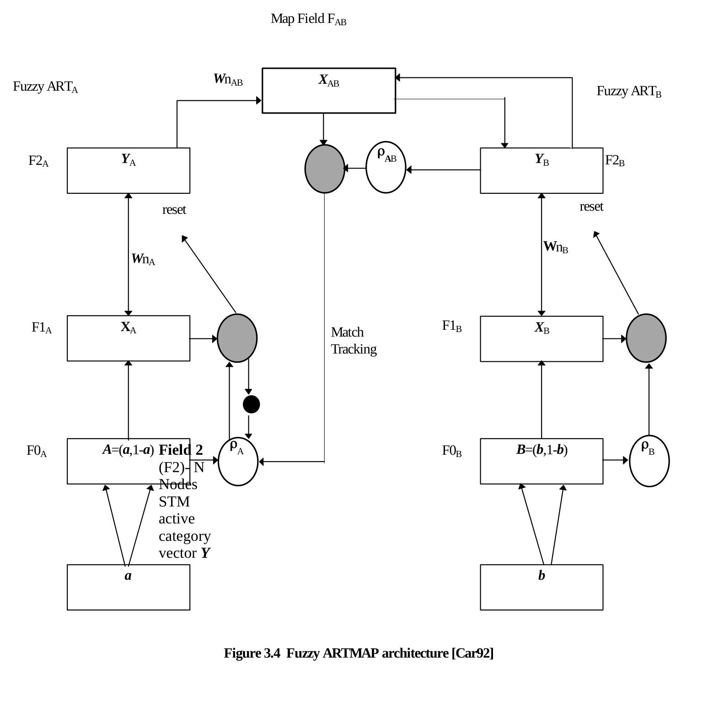

**CHAPTER THREE**

**THE FUZZY ART MAP ANN**

**3.1 Introduction to Adaptive Resonance Theory**

**ART** (**Adaptive Resonance Theory**) was developed by Stephen Grossberg at Boston University \[Gro76\]. ART is a theory about the learning dynamics of the brain which, loosely stated, says we learn new things in relation to things we already know. The use of analogies by teachers to help students relate to new concepts illustrates this learning dynamic. We pigeon-hole new information into our perceptual framework of experiences or past encounters with our environment. If the new piece of information does not fit anywhere, we expand our framework to accommodate it by broadening and redefining existing categories or creating new ones. More precisely, ART states that our learned expectations focus our attention upon sensory information in a way that protects **LTM (long term memory)** from being eroded by new learning, and enables new learning stored in **STM (short term memory)** to be automatically incorporated into LTM in a consistent manner.

ART provides a solution to the basic design problem of preserving the system’s previously learned knowledge (stability) while ensuring it continues to learn new things (plasticity) constructively. This problem of competing design goals has been termed the **stability-plasticity dilemma** \[Car88\]. This dilemma must be successfully addressed in the design of any self-adapting system. Carpenter and Grossberg have used neural networks to implement various ART architectures (e.g., ART1 \[Car87a\], ART2 \[Car87b\], ART3 \[Car90\], Fuzzy ART \[Car91\], and Fuzzy ART Map \[Car92\] ). Their latest architecture, the Fuzzy ART Map, combines fuzzy logic with ART neural networks by taking advantage of the similarity between the computations of fuzzy subsethood and ART category choice, resonance, and learning. It accepts both binary and fuzzy analog inputs, performs rapid learning while maintaining stability and plasticity, and it uses 100% of its memory capacity. It is because of these attractive performance characteristics that the Fuzzy ART Map neural network architecture was chosen for further investigation in this thesis.

Before describing the Fuzzy ART Map network, the development of ART and the role of fuzzy logic is given. The diagrams, notation and vocabulary presented reflect the conventions used in the ART literature and reflect the terminology of the field psychology from which ART was spawned.

**3.2 The Origin Of ART Development**

In 1957, 19 year old Stephen Grossberg was a psychology undergraduate at Dartmouth College. His exposure to a great deal of structured data and classical theory about learning and behavior prompted him to reach the revelation that the meaning of these data centered in issues concerning the self-organization of individual behavior in response to environmental pressures \[Gro82\]. Grossberg then sought to mathematically describe a learning theory that unified what he considered to be various cases of some neurophysiological law. His blending of psychology, physiology and mathematics makes his theories interesting but not widely understood due to their inter-disciplinary nature.

Grossberg views his theories from the network perspective. He decided that the fundamental property of his developing theory would be the representation of behavioral units as nodes and the ability for his model to perform evolutionary aggregation of these units into new representations through experience. Grossberg makes the distinction that sensory activation is the input source and short term memory is the node’s reaction to the input. The propagation of these STM signals to other nodes in the network takes place over directed pathways. LTM traces are a collection of variables that can discriminate which combination of STM signals should reach their target nodes based on past experience.

From his study of serial list learning a question arose. The figure 3.1.A represents the relationship between cumulative error and list position. It illustrates the relative difficulty of recalling items from a list of items presented serially over time. The cumulative error curve in serial verbal learning is a skewed bowed curve. Items between the middle and end of the list are hardest to learn. Items at the beginning of the list are easiest to learn. However, if the position dependent difficulty of learning was all due to interference from previously presented items, the error curve would be monotone increasing as in figure 3.1.B. Because the error curve is bowed, and the degree of bowing depends on the length of the interval between successive list presentations**,** the nonoccurrence of list items after the last item is presented somehow improves learning across several prior list items**.**

*Figure 3.1 (vector drawing recovered from rendered page)*

Grossberg felt that the backward effect that causes the bowed serial curve could only be explained using a real-time theory that could parameterize the temporal unfolding of events -- both the occurrences and nonoccurrences. The positive effect due to nonoccurring items lead him to believe that trace “images” of prior list occurrences must endure beyond the presentation time of the last item in the list, so that they could be influenced by the future nonoccurrence of items. This lead to the idea of STM traces, wherein each STM signal decays at a rate slower than the presentation rate of the sensory input. Thus as information items are serially presented to stimulate the network input nodes, a resulting STM trace captures the temporal pattern transformations of the input source. Grossberg believes that the key to developing successful learning theory is to think in terms of pattern transformations (rather than local features) as the functional units that regulate the neural designs subserving behavioral adaptation.

**3.3 Competitive Learning Models**

ART models grew out of an analysis of competitive learning models\[Car88\]. Thus, we will describe the competitive learning model as a prelude to a discussion of the ART model. Refer to Figure 3.2 for the following description of the model dynamics:

*Figure 3.2 (vector drawing recovered from rendered page)*

- An M element input vector ( ***I*** ) is presented to an input field (F1) of M nodes and induces a normalized F1 STM input trace ( ***X*** ) across the entire input field given by equation 3.1.

- Adaptive weights (Wmn) or LTM traces connect pathways between the M nodes of the input field and the N nodes of the coding field (F2) and multiply the elements of the F1 STM input trace (***X***) as it is transmitted to F2. The total signal received at the nth node in F2 is given by equation 3.2 where m=\[1..M\].

- The F2 coding field is a competitive network capable of choosing the node that receives the largest input in a “winner-take-all” manner. The output of the winning node (Yn) is set to one while the output for all other nodes is set to zero. If two or more nodes of the same maximum value, the tie goes to the node with the lowest index. The F2 STM trace at the nth node in F2 is given by equation 3.3.

- The F2 STM coding trace (***Y***) identifies the winning node and triggers associative pattern learning within the vector of LTM traces (**Wn**) that abut the winning node. The learning rule for adapting the weights is given by equation 3.4 where m=\[1..M\], n=\[1..N\] and β is a scalar learning parameter.

The literature is rich with synonyms describing the function of the network described above. The F2 STM trace is said to ***code, cluster, classify, categorize, compress, partition, orthoganalize,*** or ***vector quantize*** the input vector presented to F1. If only one node in F2 is activated in response to the presentation of an input vector, then F2 is said to have made a choice. In more general competitive learning models, compressed yet distributed F2 outputs are generated.

***X* = *I* ÷\| *I* \| (3.1)**

**Tn = ∑ Xm Wmn (3.2)**

**Yn ≡ 1 ∧ Yi ≠ n ≡ 0 ↔ ( ∀ k \| k ≠ n : Tn ≥ Tk ) ∧ ( ¬∃ iTi =Tn ∧ i \< n ) (3.3)**

**Wmn = β Yn ( Xm - Wmn ) (3.4)**

**3.4 Stability Issues**

Stability in competitive learning networks depends on the number of categories recognized by the network relative to its memory capacity or number of coding nodes in F2. If this capacity is not exceeded, then the learning of the recognition codes may stabilize depending on the structure of the input environment. As a list of input patterns is presented to F1, the recognition code generated by F2 for a given pattern in the list may differ on each successive presentation of that pattern and may never stabilize. This is due to the adaptation of the LTM traces that occurs in response to other intervening inputs. As well, stable learning may suddenly become unstable due to simple changes in the input environment (i.e., the values of the input vectors and the order in which they are presented to the network). This washing away of prior learning by new learning is the stability-plasticity dilemma. Grossberg’s ART model solves this dilemma.

**3.5 The ART Cognitive Process**

ART was introduced by Grossberg \[Gro76\] in 1976 to show how a competitive learning model could be made to perform autonomous recognition and learning of an arbitrary sequence of input patterns in a stable and efficient manner. The ART networks are similar to that shown in Fig 3.2 except they have a second top-down adaptive filter contained in feedback pathways from F2 to F1 (Fig 3.3 illustrates one example of an ART network). This allows the winning node in F2 to influence the coding of new patterns based on previous experience stored in the LTM. This top-down adaptive signal plays the role of learned expectations in an ART system. <u>The process of adaptive pattern recognition in an ART system will now be described as a special case of the more general cognitive process of hypothesis selection, test, search, classification and learning</u>:

**<u>Stage 1 -- Hypothesis Selection</u>:**

An input vector ***I*** activates input field F1 that reacts to produce the STM input trace vector ***X***. This signal from F1 activates the “hypothesis” category in F2. The F2 node receiving the largest total signal from F1 is selected as the candidate category for further testing.

**<u>Stage 2A -- Hypothesis Testing</u>:**

The candidate category selected in stage 1 is then tested when the output from F2 is sent back along adaptively controlled pathways to F1. The input vector ***I*** is then compared with the candidate category to produce a distance measure indicating the degree to which it matches previously learned expectations. A **vigilance parameter ( ρ )** acts as a similarity threshold and determines the level of similarity required between the vector pair before a match is said to occur (a match with a higher vigilance requires a shorter distance between the two vectors). If a mismatch occurs, the hypothesis search continues in stage 2B.

**<u>Stage 2B -- Hypothesis Search</u>:**

The occurrence of a mismatch in stage 2A sustains a cycle of hypothesis selection and testing until a match is found or all candidate categories have been exhausted. Each mismatch event triggers an orienting subsystem to issue a reset burst to F2 to eliminate the mismatched category from further consideration in the hypothesis search by inhibiting the output of node that represents it. Thus after each iteration, the learned expectation output of F2 is conditioned to ignore prior mismatched categories. The cycle continues until classification occurs or the full memory capacity of the system is used.

**<u>Stage 3 -- Classification</u>:**

Classification of the input vector ***I*** occurs in one of two ways: either an F2 node is chosen whose top-down expectation approximately matches input vector ***I*** , or a previously uncommitted F2 node is selected to form a new category. The latter case is performed automatically after all committed nodes in F2 have been tested without a successful match.

**<u>Stage 4 -- Learning</u>:**

When classification occurs, the LTM trace that abuts the F2 category node is updated to incorporate the data from input vector ***I***. If the full capacity of the network has been exhausted and classification does not occur, learning is automatically inhibited.

**3.6 When Does Adaptive Resonance Occur?**

During the hypothesis search cycle the values of the STM traces change faster than the more slowly varying LTM traces can follow and essentially no learning occurs. When a match is found, the search cycle stops and the system becomes locked into a resonant state of STM activation, which is produced by the fusion of mutually reinforcing signal patterns from the bottom-up input vector and the top-down learned expectation feedback signal generated by the selected category in F2. This steady resonant state stabilizes the STM values to produce an attentional focus that allows the LTM traces to learn or “adapt” to new information represented in the fused activation pattern across F1. **The fact that learning only occurs in a state of resonance suggested the name adaptive resonance theory \[Gro82\].**

**3.7 The ART Advantage**

An ART architecture differs from other popular neural networks in a number of ways. Its main advantage is that it is designed to work well in an autonomous setting, learning in a quick yet stable manner in an ever changing environment while being exposed to an arbitrary sequence of input patterns, until its full memory capacity is utilized. Table 3.1, drawn from \[Car88\], lists the learning properties of ART architectures.

|  |
|:--:|
| **ART Architecture Learning Properties** |
| Real-time (on-line) learning |
| Self-organizing (unsupervised) |
| Nonstationary world |
| Memory self-stabilizes in response to arbitrarily many inputs |
| Effective use of full memory capacity |
| Maintain plasticity in an unexpected world |
| Learn internal top-down expectations |
| Active attentional focus regulates learning |
| Slow or fast learning |
| Learn in approximate-match phase |
| Use self-regulating hypothesis testing to globally reorganize the energy landscape |
| Fast adaptive search for best match |
| Rapid direct access to codes of familiar events |
| Variable error criterion (vigilance parameter) sets coarseness of recognition code in response to environmental feedback |
| All properties scale to arbitrarily large system capacities |

**Table 3.1 ART Architecture Learning Properties**

**3.8 Fuzzy Logic**

Before our description of the Fuzzy ART and Fuzzy ART Map ANNs in the next sections of this chapter, we pause to review that portion of fuzzy logic which plays a key role in the distance measures used by the these ANNs. The following introduces some basic concepts of fuzzy logic to the reader in order to appreciate its contribution. To start with, let us compare its characteristics with those of binary logic in table 3.2 below.

<table>
<colgroup>
<col style="width: 21%" />
<col style="width: 34%" />
<col style="width: 43%" />
</colgroup>
<tbody>
<tr>
<td></td>
<td><strong>Binary Logic</strong></td>
<td><strong>Fuzzy Logic</strong></td>
</tr>
<tr>
<td><strong>Truth Value</strong></td>
<td>true or false</td>
<td>a fuzzy subset of a truth value set</td>
</tr>
<tr>
<td><strong>Predicates</strong></td>
<td>crisp (e.g. is even)</td>
<td>crisp or general (e.g. is tall)</td>
</tr>
<tr>
<td><strong>Quantifiers</strong></td>
<td>all, some</td>
<td>all, some, most, many, several, few, much of, frequently, occasionally, etc.</td>
</tr>
<tr>
<td><strong>Predicate Modifiers</strong></td>
<td>not</td>
<td>not, very, more or less, extremely, slightly, etc.</td>
</tr>
<tr>
<td><strong>Qualification</strong></td>
<td>
truth value (e.g. is true)

modal operator (e.g. is necessary)

intentional operator (e.g. know that)
</td>
<td>
truth value (e.g. is not quite true)

probability (e.g. is unlikely)

possibility (e.g. is almost impossible)
</td>
</tr>
</tbody>
</table>

**Table 3.2 Fuzzy Logic Compared To Binary Logic**

**3.8.1 Parallels in Fuzzy Logic and ANNs**

Fuzzy logic is concerned with the formal principles of approximate reasoning. Like ANNs, it aims at modeling the imprecise modes of reasoning that play an essential role in the remarkable human ability to make rational decisions in an environment of uncertainty and imprecision. Fuzzy logic represents the meaning of a lexically imprecise proposition as an elastic constraint on a variable and deduces the answer to a query through a propagation of elastic constraints. Compared to ANNs, the proposition plays the role of artificial neuron that maps an input vector (a collection of variables) to an output vector (elastic constraint). The propagation of elastic constraints is analogous to the propagation of input values through the nodes of an ANN from input to output layer. A fuzzy logic system is typically implemented in software and consists of a fuzzy algorithm and control rules, much like an ANN program whose architecture and weight matrix define the relationship between its nodes.

A main concern to both fuzzy logic and neural networks is the development of the ability to generalize or infer an output based on accumulated experience. A branch of fuzzy logic, termed dispositional logic \[Zad88\], deals with propositions that are preponderantly but not necessarily true (e.g., snow is white). The main concern of dispositional logic lies in the development of rules of inference from commonsense knowledge. This is analogous to the development of ANN designs to improve their ability to generalize an output based on an interpolation from known information provided in a training set.

**3.8.2 The Proposition**

A proposition ***p*** may be viewed as a collection of elastic constraints, C1,...,Ck, which restrict the values of a collection of variables ***X* =** \[X1,...,Xn\] \[Zad88\]. The proposition defines a transfer function that maps ***X*** to conform to ***C*** . This is analogous to the mapping performed by a single artificial neuron or a network of neurons. The ANN architecture enables it to learn certain types of mappings, but the propositional knowledge required to perform these mappings is stored in the weights. Training the network to produce desired outputs (elastic constraints) when presented with specific input vectors (collections of variables) is similar to the definition of a fact and rule base for a fuzzy logic program.

**3.8.3 The Possibility Distribution Defined By Proposition**

The proposition can be viewed as a definition of the possibility distribution of a given variable. Consider the canonical form of a proposition according to \[Zad88\] shown in equation 3.5. This infers that the possibility distribution of ***X*** is equal to ***C*** as in equation 3.6. This in turn infers equation 3.7, where **μ*C ***is the membership function of ***C*** and **Poss{ *X* = u }** is the possibility that ***X*** may take **u** as its value.

***p* → *X* is *C*** **(3.5)**

**Π*X* = *C*** **(3.6)**

**Poss{ X = u } = μC(u), u ∈ U (3.7)**

The proposition ***p*** constrains the possible values that ***X*** can take and thus defines its possibility distribution. In other words ***p*** applied to ***X*** produces ***C*** or **p → *X* is *C***, which takes us back to the original canonical form in equation 3.5 . The canonical form of a proposition is seen in the field 1 activity equation of the Fuzzy ART ANN shown in figure 3.3 and given by equation 3.8. Here the proposition ***W*n** maps the variable ***I*** to the elastic constraint ***X.***

min( ***W*n , *I*** ) **= *X*** which can be restated as ***W*n → *I* is *X .* (3.8)**

**3.8.4 The Quantified Proposition**

A quantified proposition, ***p* → proportion of A’s that are B’s is Q ,** infers the degree to which ***A*** is a fuzzy subset of ***B***. Take for example the quantified proposition “most tall men are thin”. This proposition has a definition of the form ***p*** ≡ **Q A’s are B’s** , where Q = “most”, A = “tall men” and B = “thin men”. According to this proposition, the proportion of tall men that are thin men is the quantity called “most”. Restated, this proposition asserts that the degree to which the set of tall men (***A***) is a fuzzy subset of the set of thin men (***B***) is defined by the quantity most (Q).

In fuzzy logic the **relative sigma count** ∑count(***B*/*A***) described in equation 3.9 is used to measure the relative population of ***B*** in ***A*** .This is equivalent to the proportion of A’s that are B’s or **the degree to which *A* is a fuzzy subset of *B*.**

∑count(***B*/*A***) **=** <u>∑j min( μΑ(uj) , μΒ(uj) )</u> **(3.9)**

∑j μΑ(uj)

where j = \[1, ...,m\] and ***U*** is a finite set {u1,...,um}

**3.8.5 Fuzzy Logic Applied To Adaptive Resonance Theory**

The relative sigma count function is seen in the Fuzzy ART ANN in both the choice function (equation 3.10) and match function (equation 3.16). Although formally introduced in the next sections, they are previewed here for convenience to appreciate their origin in fuzzy logic quantified propositions:

**<u>Choice Function T</u>**:

Tn ( ***I*** ) ≡ <u>\| min( ***I, W*n** ) \|</u>

α **+ \| *W*n \|**

The proportion of ***W*n** that is ***I***

The degree to which ***W*n** is a fuzzy subset of ***I***

The relative population of ***I*** in ***W*n**

**<u>Match Function M</u>**:

M( ***I, W*n **) **=** <u>**\|** min( ***I, W*n** ) **\|**</u>

\| ***I*** \|

The proportion of ***I*** that is ***W*n**

The degree to which ***I*** is a fuzzy subset of ***W*n**

The relative population of ***W*n** in ***I***

**Note**: norm operator \| ***P*** \| ≡ sum( abs( ***P*** ) )\|

Comparing the quantified proposition, ***p* → proportion of A’s that are B’s is Q,** to the canonical form ***p* → *X* is *C***, one can see the constrained variable ***X*** is the relative sigma count ∑count(***B*/*A***) and Q is the elastic constraint to which ***X*** is subjected.

**3.9 The Fuzzy ART ANN**

This section marks the beginning of a detailed discussion of the mechanics of the ANN used in the construction of the ASR system detailed in chapter five. The information in the preceding chapters was presented to provide a general background to the origins of this ANN. The Fuzzy ART ANN presented here forms the key component of the Fuzzy ART Map ANN presented later in section 3.11.

The Fuzzy ART network \[Car91\] combines fuzzy logic with ART neural networks by taking advantage of the similarity between the computations of fuzzy subsethood and ART category choice, resonance, and learning. Its fuzzy input values range continuously from zero to one, thus it is capable of accepting analog as well as binary input. It is capable of performing rapid single presentation unsupervised learning of arbitrarily presented input patterns while maintaining its stability and plasticity. Just as other ART architectures, it can use 100% of its memory capacity.

The Fuzzy ART ANN model is shown in figure 3.3. (Note: the orienting subsystem and reset mechanism have been omitted here for clarity -- they can be seen in the Fuzzy ART Map model depicted in figure 3.4.) It contains three fields labeled F0, F1 and F2. The first field (F0) consists of M input terminals across which the current fuzzy valued input pattern ***I*** is presented. The second field (F1) consists of M artificial neurons with fuzzy activation functions. The third field (F2) consists of N artificial neurons that perform a category choice function. The nodes in F1 and F2 are fully inter-connected and an adaptive weight matrix ***W*** modifies signals transferred between the two fields. Wmn is subscript notation used in ART network literature referring to the weight connection between the mth F1 node and the nth node in F2. When the network is first initialized, ***W*** takes on the value of an M by N unity matrix.

*Scanned from the printed thesis.*

*Scanned from the printed thesis.*

**3.10 An Eight Stage Fuzzy ART Algorithm**

The learning algorithm for the Fuzzy ART ANN will now be described as an eight stage process. The reader is encouraged to refer to the network diagram in figure 3.3 for further clarification. As well, table 3.3 provides a bird’s eye view of all eight stages to help the reader gain perspective of each stage in the following algorithm:

**<u>Stage One -- Initial Input</u>:**

The input signal from each F0 terminal ( Im ) feeds directly to the F1 neuron opposite to it. The F1 neurons combine this input with the F2 output feedback to produce the F1 STM activity vector ***X***. On initial presentation of the input vector ***I*** when there is no feedback yet produced by F2 output, the value of ***X*** is equivalent to ***I***.

**<u>Stage Two -- Choice Function</u>:**

The input to the nth F2 node is defined by a **choice function Tn( *I* )** defined in equation 3.10. The choice function provides a similarity measure describing the degree to which the nth LTM trace is a fuzzy subset of the input vector ***I***. The nth LTM trace refers to the weight vector (***W***n) that abuts the nth F2 node given by ***W*n** **=** \[**W1n, W2n, ... Wmn, ... WM-1,n, WMn**\]. Equation 3.10 introduces the reader to the positive non-zero **choice parameter α** . The **norm operator** is restated for convenience in equation 3.11.

Tn( ***I*** ) ≡ <u>\| min( ***I, W*n** ) \|</u> Choice Function **(3.10)**

α **+ \| *W*n \|**

**\| *Vector* \| ≡** sum**(** abs**( *Vector* ) )** Norm Operator **(3.11)**

**<u>Stage Three -- Category Choice</u>:**

The system is said to make a **category choice** when the F2 neuron with the maximum input signal is chosen. If more than one neuron has maximal input, then the neuron with the smallest index is chosen. The conditions for category choice are given by equation 3.12.

Tmax ≡ max( Tn ) ∧ (¬∃ iTi = Tmax ∧ i \< n) Category Choice **(3.12)**

**<u>Stage Four -- STM Vector Y</u>:**

The output of the chosen neuron is set equal to one and all other neuron outputs are set equal to zero. The output of F2 is the STM active category vector ***Y*** given by equation 3.13.

( Yn ≡ 1 ) ∧ ( Yi≠n ≡ 0 ) ↔ Tn = Tmax F2 STM Vector *Y* **(3.13)**

**<u>Stage Five -- STM Vector X</u>:**

The F2 output vector is sent back into F1 through the adaptive weight matrix ***W***. Since only **Yn** is non-zero and is of unit value, the feedback vector from F2 to F1 is equal to ***W*n .** Equation 3.14 describes the STM activity vector ***X*** output by F1 as the “fuzzy AND” or minimum of this top-down F2 feedback vector and the bottom-up F0 input vector ***I*** . It should be re-emphasized that upon initial exposure to the input vector ***I***, F2 is inactive and there is no feedback vector from F2 to F1. This initial condition is described by equation 3.15 and indicates the output from F1 is simply that of the input vector ***I*** .

***X* ≡** min( ***I, W*n** ) ↔ Yn = 1 F1 STM Vector *X* **(3.14)**

***X* ≡ *I*** ↔ ¬∃ iYi = 1 X when F2 Inactive **(3.15)**

**<u>Stage Six -- Match Function</u>:**

Next the match function given by equation 3.16 provides a similarity measure of the degree to which the input vector ***I*** is a fuzzy subset of the F2 feedback vector. (Note: this feedback vector is equal to ***W*n** and represents the centroid of the cluster chosen by the category choice.)

M( ***I, W*n **) **=** **\|** min( ***I, W*n** ) **\|** / \| ***I*** \| Match Function M **(3.16)**

**<u>Stage Seven -- Mismatch Condition</u>:**

If the match value is less than the vigilance parameter , then the match does not support resonance and a mismatch condition defined by equation 3.17 results. A mismatch triggers an orienting subsystem to issue a **reset** burst to F2 to eliminate the mismatched category from further consideration in the hypothesis search by inhibiting the output of the node that represents it. Equation 3.18 shows that the category function for the node is reset to zero. After this, the learning cycle returns to the hypothesis search by the selection of a new category choice.

M( ***I, W*n **) **\<** ρ Mismatch Condition **(3.17)**

Tn( ***I*** ) ≡ 0 Reset Action **(3.18)**

**<u>Stage Eight -- Resonance Condition</u>:**

If the match value is greater than or equal to the preset fuzzy valued **vigilance parameter ρ,** then a resonance condition defined by equation 3.19 exists. Resonance stabilizes the F1 output long enough to allow learning to occur through the adjustment of the adaptive weight vector ***W*n** according to the Fuzzy ART learning rule given by equation 3.20 which includes the fuzzy valued **learning parameter β.**

M( ***I, W*n **) **≥** ρ Resonance Condition **(3.19)**

***W***nnew ≡ β( min(***I, W*n** ) ) + ( 1-β )***W***nold Fuzzy ART Learning Rule **(3.20)**

**<u>Summary Chart</u>**

This ends the Fuzzy ART ANN learning algorithm. A condensed summary of the eight stage process outlined above is provided in table 3.3. This algorithm is important because it is employed in the Fuzzy ART Map ANN discussed in the next section.

<table>
<colgroup>
<col style="width: 8%" />
<col style="width: 36%" />
<col style="width: 55%" />
</colgroup>
<tbody>
<tr>
<td style="text-align: center;"><strong>Stage</strong></td>
<td style="text-align: center;"><strong>Action</strong></td>
<td style="text-align: center;"><strong>Applicable Equation</strong></td>
</tr>
<tr>
<td style="text-align: center;"><strong>1</strong></td>
<td style="text-align: left;">Input vector I presented at F0 and initial F1 output X is calculated</td>
<td style="text-align: center;"><em><strong>X</strong></em> = <em><strong>I</strong></em></td>
</tr>
<tr>
<td style="text-align: center;"><strong>2</strong></td>
<td style="text-align: left;">Choice function determines input to F2</td>
<td style="text-align: center;">
Tn ( <em><strong>I</strong></em> ) ≡ <u>| min( <em><strong>I</strong></em>, <em><strong>Wn</strong></em> ) |</u>

α + | <em><strong>Wn</strong></em> |
</td>
</tr>
<tr>
<td style="text-align: center;"><strong>3</strong></td>
<td style="text-align: left;">Category choice is made</td>
<td style="text-align: center;">Tmax ≡ max( Tn ) ∧ (¬∃ iTi = Tmax ∧ i &lt; n)</td>
</tr>
<tr>
<td style="text-align: center;"><strong>4</strong></td>
<td style="text-align: left;">F2 output Y is determined</td>
<td style="text-align: center;">( Yn ≡ 1 ) ∧ (Yi≠n ≡ 0 ) ↔︎ Tn = Tmax</td>
</tr>
<tr>
<td style="text-align: center;"><strong>5</strong></td>
<td style="text-align: left;">F1 output X recalculated</td>
<td style="text-align: center;"><em><strong>X</strong></em> = min( <em><strong>I</strong></em>, <em><strong>Wn</strong></em> )</td>
</tr>
<tr>
<td style="text-align: center;"><strong>6</strong></td>
<td style="text-align: left;">Match function calculated to determine reset or resonance condition</td>
<td style="text-align: center;">M( <em><strong>I</strong></em>, <em><strong>Wn</strong></em> ) = | min( <em><strong>I</strong></em>, <em><strong>Wn</strong></em> ) | / | <em><strong>I</strong></em> | = | <em><strong>X</strong></em> | / | <em><strong>I</strong></em> |</td>
</tr>
<tr>
<td style="text-align: center;"><strong>7</strong></td>
<td style="text-align: left;">If mismatch condition, then reset action and go to category choice (stage 3 above).</td>
<td style="text-align: center;">M( <em><strong>I</strong></em>, <em><strong>Wn</strong></em> ) &lt; ρ → Tn ( <em><strong>I</strong></em> ) ≡ 0</td>
</tr>
<tr>
<td style="text-align: center;"><strong>8</strong></td>
<td style="text-align: left;">If resonance condition, then apply learning rule</td>
<td style="text-align: center;">M(<em><strong>I</strong></em>,<em><strong>Wn</strong></em> ) ≥ ρ → <em><strong>Wn</strong></em>new ≡ β(min(<em><strong>I</strong></em>,<em><strong>Wn</strong></em>) ) + (1-β)<em><strong>Wn</strong></em>old</td>
</tr>
</tbody>
</table>

**Table 3.3 An Eight Stage Fuzzy ART Algorithm**

**3.11 The Fuzzy ART Map ANN**

The Fuzzy ART Map neural network is a network which consists of two Fuzzy ART sub-networks or modules linked by an associative learning network called a Map Field. Figure 3.4 illustrates the Fuzzy ART Map architecture as described in \[Car92\].

During supervised learning, the ARTA module receives a stream of **training** input vectors ***a*** , and the ARTB module receives a stream of **target** input vectors ***b*** . The Fuzzy ARTA module’s complement coding preprocesssor transforms the vector ***a*** to ***A***=(***a***,1-***a***) at field F0A . The complement coded vector ***A***, now twice the dimension of ***a***, is the input vector to field F1A . Similarly, the input to field F1B is the complement coded vector ***B***=(***b***,1-***b***). Both ARTA and ARTB modules activate an output category node in F2A and F2B (respectively) in the manner described in section 3.10 above.

The map field FAB is activated whenever one of the ARTA or ARTB categories is active. If node J of F2A is chosen, then its weights ***W***jAB activate FAB. If node K in F2B is active, then the node K in FAB is activated by one to one pathways between F2B and FAB. If both ARTA and ARTB are active, then FAB becomes active only if ARTA predicts the same category as ARTB via the weights ***W***jAB. The FAB output vector ***X***AB obeys the following equations:

- if the Jth F2A node is active and F2B is active then ...... ***X***AB = ***Y***B ∧ ***W***jAB (3.21)

- if the Jth F2A node is active and F2B is inactive then .... ***X***AB = ***W***jAB (3.22)

- if F2A is inactive and F2B is active then ....................... ***X***AB = ***Y***B (3.23)

- if F2A is inactive and F2B is inactive then .................... ***X***AB = 0 (3.24)

By equation 3.21, XAB = 0 if the category selected by ARTA does not match that selected by ARTB. This inhibition of the map field FAB activation induces the **match tracking** process. Match tracking raises the Fuzzy ARTA vigilance (ρA) just above the F1A to F0A match ratio \|***X***A\|÷\|***A***\|. This triggers a Fuzzy ARTA search that leads to activation of either a Fuzzy ARTA category that correctly predicts target input vector ***b*** or to a previously uncommitted Fuzzy ARTA category node.

This supervised training method allows each output node of the ARTA network to be assigned a label (by the map field) indicating which class or parent category it represents. When the ARTA network trains on an input vector, it first attempts to recognize it. If it cannot match the input vector to the target output class provided by the ARTB network, then the ARTA network memory is updated. The ARTA network is also updated if it did classify the input vector correctly, but the similarity of the match was below a fixed baseline similarity. This learning method allows the network to discriminate between input vectors which represent new data and those which contain data already learned. As well, the mapping of the output nodes of the ARTA network into different class groups allows the network to be trained to recognize patterns that are not linearly separable, as demonstrated by the two-spiral test in \[Car92\]. The Fuzzy ART Map network can perform this mapping in one presentation of the training set. These qualities that make this network an attractive candidate for adaptive pattern recognition within a large abstract information database.

Chapter five will describe the implementation of the Fuzzy ART Map architecture in a software ANN program. Since software simulations are not bound by the same physical limits as the systems they simulate, many of the structures shown in figure 3.4 are replaced by functional equivalents to simplify the program design.

**3.12 Chapter Summary**

This chapter presented three main thrusts -- an overview of Adaptive Resonance Theory, an introduction to Fuzzy Logic, and a description of two types of *Fuzzy* ART ANNs:

- The origin of ART was discussed with respect to its growth from the study of serial list learning error, competitive learning models, and stability issues. In keeping with its roots in the field of psychology, the ART algorithm was described in terms of the general cognitive process of hypothesis selection, test, search, selection, classification, and learning. An explanation of how the theory attained its name and a comparison of ART architectures and other learning schemes was made.

- Fuzzy Logic was introduced through comparisons to binary logic and analogies to Artificial Neural Networks. The raison d’être for this section was to introduce the reader to the concept of the quantified proposition and its role in the “relative sigma count function” distance measure used in Fuzzy ART ANNs.

- The Fuzzy ART ANN learning algorithm was presented which incorporated both the ART learning process and the Fuzzy Logic distance measure. For the sake of clarity, the algorithm was detailed in eight stages using both text and mathematical descriptions. The Fuzzy ART Map ANN was then described as an architecture formed by two communicating Fuzzy ART ANN sub-networks.

This chapter is important to the reader’s appreciation of the role that the Fuzzy ART Map ANN plays as the recognizer component in the ASR system described in chapter five. By understanding how the Fuzzy ART Map ANN works, the reader will recognize what portion of the success (or failure) of the ASR system is attributable to the ANN recognizer component. The feature extraction process is as important to the successful performance of an ASR system -- this aspect is covered next in chapter four.
