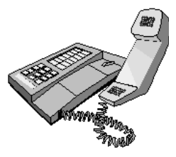
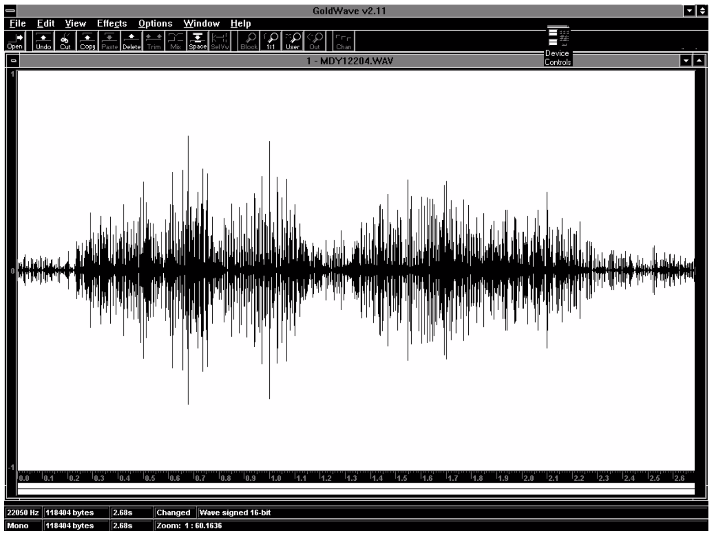
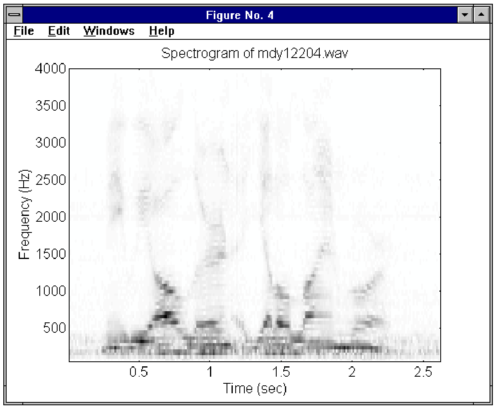
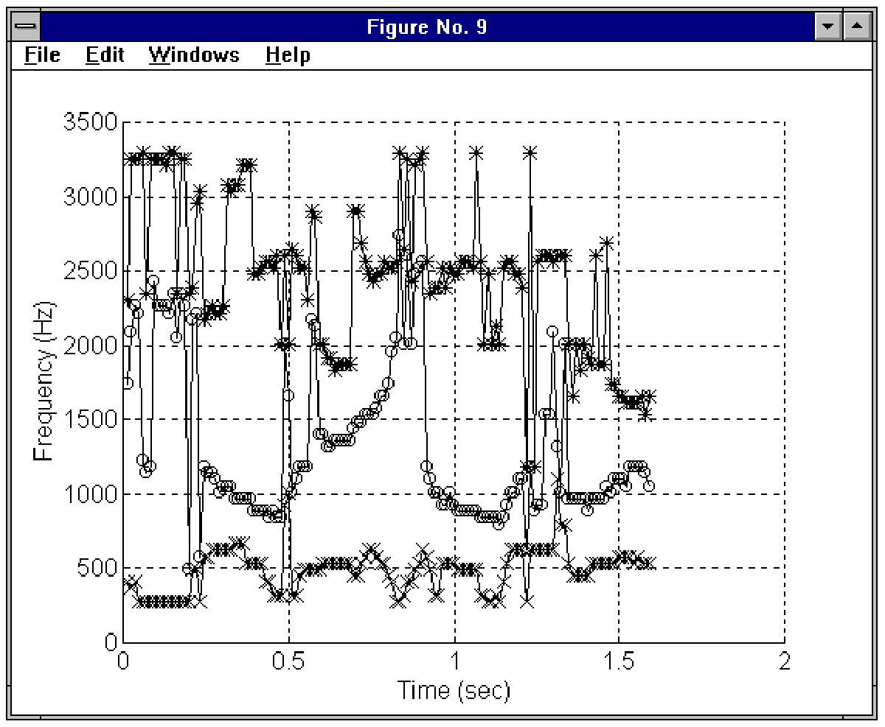
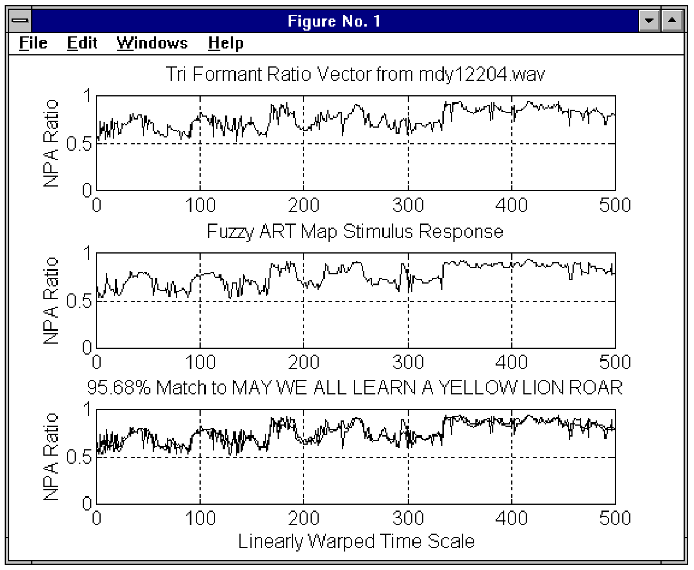
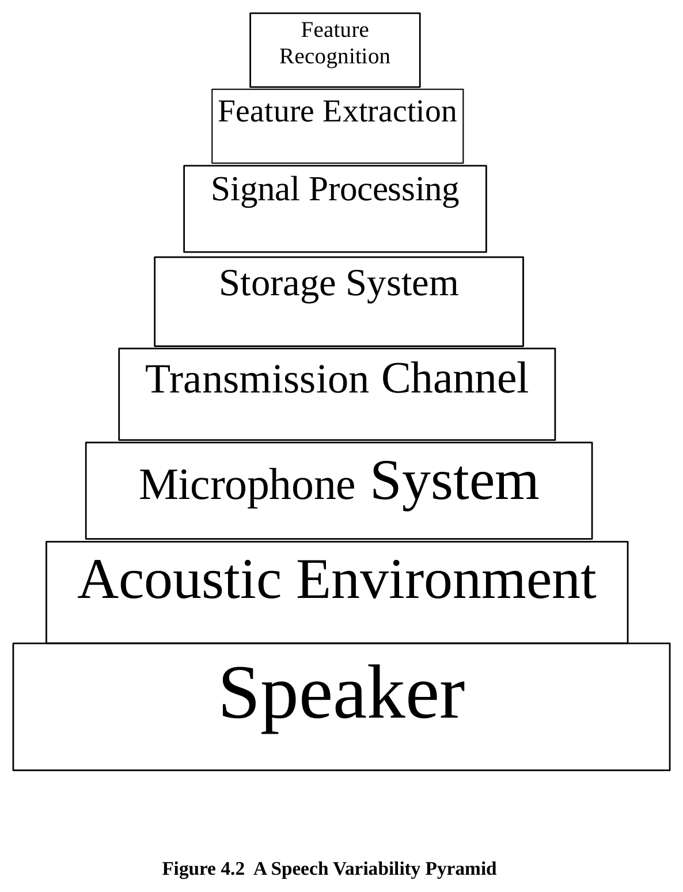
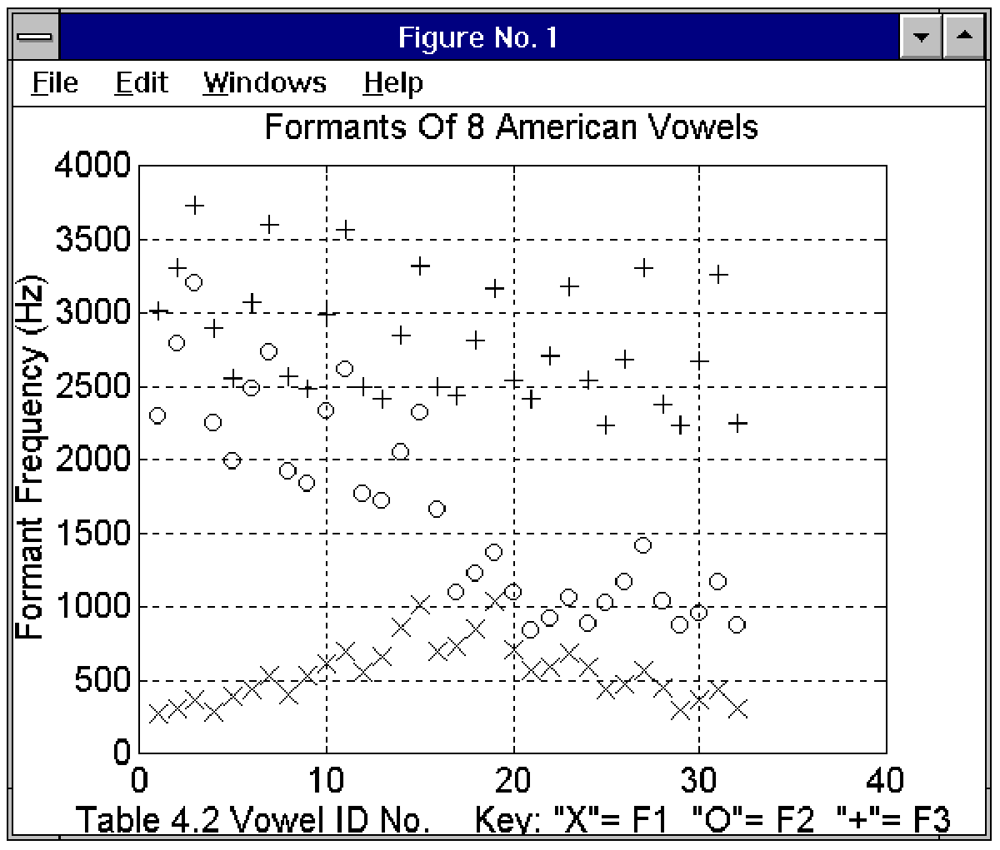
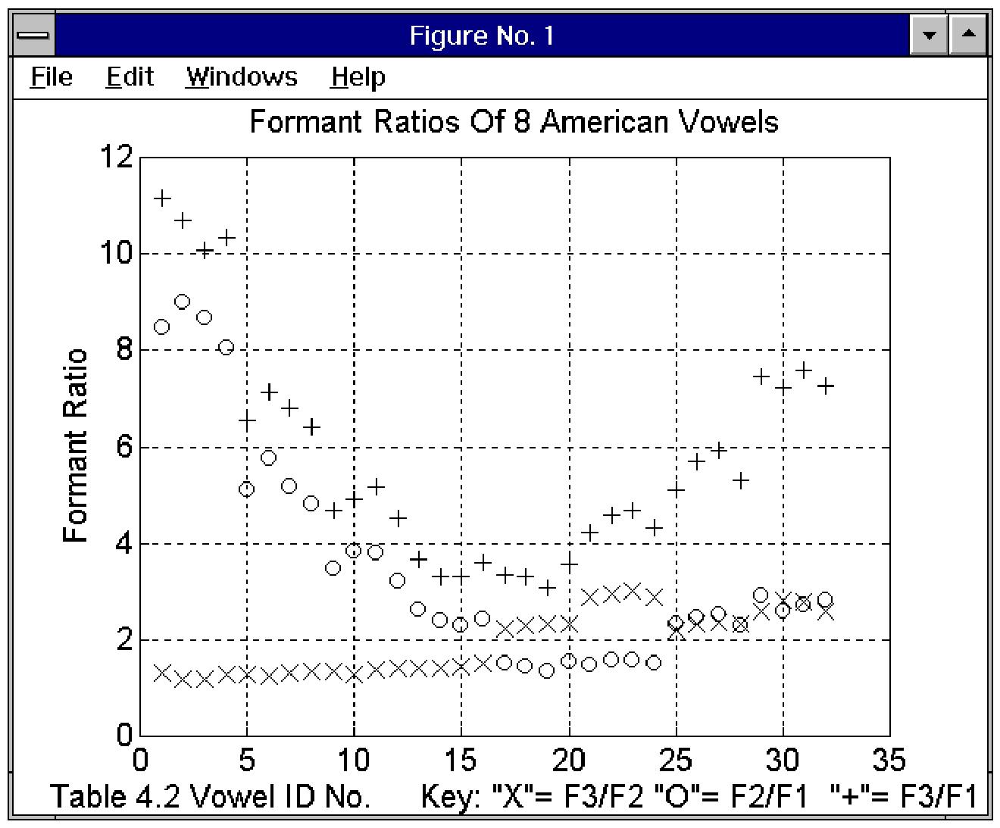
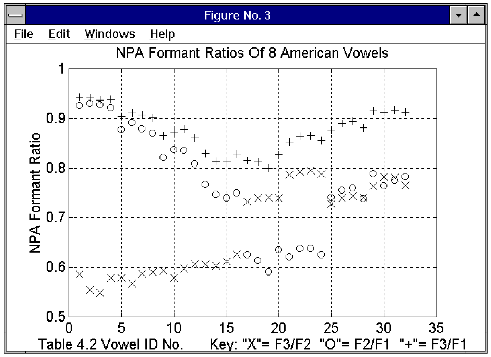

**CHAPTER FOUR**

**AUTOMATIC SPEECH RECOGNITION**

**4.1 Introduction**

Automatic speech recognition refers to the use of a machine to perform the unambiguous identification of linguistic elements present in an utterance of spoken human language. ASR is the first step in a spoken language system that recognizes a person’s words, interprets their meaning and provides an appropriate response. Research concerning spoken language systems is important since it will enable people to interact with computers using speech, thus making it easier for people without computer training to access computer-based resources.

This chapter presents material in four main areas. First, it gives a background to ASR systems by discussing their classification and general operating process. Next, some of the ASR research concerns affecting the design of ASR systems are presented. Third, the production and perception of human speech are examined to provide a basic vocabulary of the subject to the reader. The last section in the chapter introduces Formant Ratio Theory, which forms the basis for the signal processing methods used in the ASR system implemented in chapter five.

**4.2 ASR System Classification**

ASR systems can be classified by their performance regarding the number of speakers they support (speaker dependency), the manner of speech that they accept (discrete or continuous), and the size of their active vocabulary. The following sub-sections describe each of these categories in more detail and table 4.1 illustrates this classification scheme applied to some of today’s commercially available ASR systems:

**4.2.1 Speaker Dependency**

A speaker dependent system is developed to operate for a single speaker. These systems are usually easier to develop, cheaper to buy and more accurate, but not as flexible as speaker adaptive or speaker independent systems. A speaker independent system is developed to operate for any speaker of a particular type (e.g., American English). These systems are the most difficult to develop, most expensive to buy and accuracy is lower than speaker dependent systems; however, they are more flexible. A speaker adaptive system is developed to adapt its operation to the characteristics of new speakers. Its development effort lies somewhere between speaker independent and speaker dependent systems \[CSN95\].

**4.2.2 Manner of Speech**

A discrete speech system operates on a single word at a time and requires a pause between the utterance of each word in a phrase. This is the simplest form of recognition to perform because the ends of a word are easier to find and the pronunciation of a word tends not affect others. Thus, because the occurrences of words are more consistent, they are easier to recognize. A continuous speech system operates on speech in which words are connected (i.e., not separated by a pause). Continuous speech is more difficult to handle because of a variety of effects. First, it is difficult to detect the word boundaries. Another problem is “coarticulation". The production of each phoneme is affected by the production of surrounding phonemes, and similarly the beginning and ending of each word are affected by the words that precede and follow it. The recognition of continuous speech is also affected by the rate of speech, where recognition accuracy tends to decrease as the rate of speech increases.

**4.2.3 Active Vocabulary Size**

The number of words that a system can recognize at a given instant is referred to as its active vocabulary size. The size of the active vocabulary of a speech recognition system affects the complexity, processing requirements and the accuracy of the system. System accuracy can be adversely influenced if some of the words within the active vocabulary are acoustically similar. This condition becomes more likely as the size of the active vocabulary grows. The recognition of discrete phrases can be used to increase system recognition accuracy since the acoustic dissimilarity between phrases is generally greater than that of words alone. Some ASR systems use **context switching** (fast loading and unloading of active vocabulary modules) to provide a larger virtual active vocabulary. This technique is analogous to a computer operating system’s use of hard drive swap space to increase the apparent size RAM available to programs. The size of an ASR system’s active vocabulary varies with the task it is required to do; some applications only require a few words (e.g., numbers only) while others require very large dictionaries (e.g., dictation machines).

|  |  |  |  |
|----|:--:|:--:|:--:|
| ***Product*** | ***Speaker Type*** | ***Speech Type*** | ***Active Vocabulary*** |
| **Voice Blaster 4.0** | dependent | discrete | 1024 words |
| **Votan** | dependent | discrete or continuous | 255 words |
| **VoiceServer** | dependent | discrete | 1000 words |
| **DragonDictate 3.0** | adaptive | discrete | 60,000 words |
| **DragonVoiceTools** | adaptive | discrete | 1,000 words |
| **Kurzweil Voice** | adaptive | discrete | 60,000 words |
| **PowerSecretary** | adaptive | discrete | 30,000 words |
| **VoiceType Dictation** | independent | discrete | 22,000 words |
| **Phonetic Engine 400** | independent | continuous | 2,000 words |
| **Visus SpeechKit** | independent | continuous | 1,000 words |
| **DATAVOX -- French** | independent | continuous | 50 words |
| **ICSS system from IBM** | independent | continuous | 1,000 words |

**Table 4.1 Performance Classification Of Some Commercial ASR Systems \[CSN95\]**

**4.3 A Four Stage ASR Process**

ASR can be described in terms of a four stage process consisting of speech recording, signal processing, feature extraction and utterance classification \[Whi76\]:

- The first stage is the sound recording stage and deals with the capture of the speech sample. This stage concentrates on the efficient reception and conversion of the acoustic signal from the speaker to an electronic equivalent that is then stored for further processing.

- The next stage is the signal processing stage and is concerned with spectral analysis. This stage concentrates on the initial analysis of the electronic speech signal to produce a parametric representation that encodes spectral information either explicitly or implicitly \[Whi76\]. This stage can also be referred to as the “front end” or preprocessing stage.

- The third stage is the feature extraction stage and is concerned with the removal of redundant or irrelevant information from the parametric representation produced in stage two. This results in data compression and reduced computational load for all subsequent processing. One example of feature extraction is formant tracking, which is the monitoring of the time evolution of the major peaks of the short-term power spectrum of speech. The formants are produced by resonance in the vocal cavity of the speaker. They provide excellent data compression since *most* of the information content of speech is carried by the time evolution of the first three formants or resonance frequencies \[Whi76\].

- The last stage is the utterance classification stage and is concerned with identifying what has been said. This stage involves the recognition of phonemes, groups of phonemes, words or phrases, aided by many processes such as DTW (Dynamic Time Warping), HMM (hidden Markov modeling), or ANNs. (Note: more information on these techniques can be found in \[Ain88\] and \[Fur89\].) ASR systems may also use some knowledge of the language to aid the recognition process.

 

Stage \#1 - **Sound Recording**

Stage \#2 - **Signal Processing**

Stage \#3 - **Feature Extraction**

 

Stage \#4 - **Utterance Classification**

**Figure 4.1 A Four Stage ASR Process**

**4.4 Applicable ASR Research Areas**

The ASR system developed as part of this thesis work addresses issues related to two key areas of basic research in spoken language systems as described in \[Col95\]. These areas of concern include increasing the speed and ease of training ASR systems, and improving the robustness of speech recognition performance when systems are employed in realistic acoustic environments. Both of these problems are described in more detail below:

**4.4.1 Rapid Training**

Currently, ASR systems must learn large amounts of task-specific data for reasonable performance in a given application. This activity is expensive due to the time required to complete the task and the caliber of personnel required to do the job. Until researchers develop faster and less labor intensive methods of adapting ASR systems to new applications, ASR systems will only be created for those few applications whose high return will offset the system’s training costs.

An ASR system capable of rapidly learning new speech data, in a manner independent of speaker type or spoken language, is highly desirable. Ideally, this new speech data should be stored in a modular manner such that subsets of domain knowledge could be combined into packages customized for new applications, without the need for extensive system retraining. These design goals were incorporated in the implementation of the ASR system described in chapter five.

**4.4.2 Robust Speech Recognition**

**Robustness** in speech recognition can be defined as **minimal performance degradation due to changes in the input conditions of the acoustic signal** \[Col95\]. The input conditions of the acoustic signal are the result of factors related to the acoustic environment, the microphone system, the transmission system, and the variability of human speech. Each of these areas of concern is discussed below with respect to its impact on the design considerations of future ASR systems.

**4.4.2.1 The Acoustic Environment**

The acoustic environment of practical ASR applications should include those environments in which computers are currently operated today. An ASR system that cannot function in the office environment where a computer is normally located is less than ideal. Thus an ASR system must be able to effectively deal with ambient noise (unwanted signal originating outside the ASR system). Enclosures that isolate the speaker and the ASR system in a controlled acoustical environment have limited applications due to the restricted mobility they impose on the speaker. An example of the appropriate use of an enclosure is the Texas Instruments access control system, described in \[Dod76\], in which an enclosed 4’x5’ foyer is used to improve the acoustic environment as well as imprison persons trying to gain unauthorized access to the computer room.

**4.4.2.2 The Microphone System**

The microphone system is of primary importance to the effective capture of the speech signal since it acts as the ears of the system. Ideally, speakers should not be restricted by having to use a head-mounted or hand-held microphone when communicating with a machine. Thus it is highly desirable to have a remote microphone attached to the ASR system. An ideal microphone system should perform as well as the human auditory system. With binaural stereo imaging of the auditory scene, the microphone system could spatially pinpoint the speech source and then isolate its signal by ignoring sound emanating from all other points. With a swivel mounted steering system (like that of the human head and neck), the microphone system could effectively track and focus its array on a mobile speech source.

Simpler techniques of noise reduction can be applied to a conventional single microphone system that will improve ASR performance. Spectral measurements of the ambient noise can be used by an ASR system to mask out the effects of steady background noise frequencies below the measured threshold amplitude. As well, a microphone enclosure can be used to attenuate sound emanating from sources outside a given target zone (spatial filtering) including reverberation (sound reflections within a given room).

**4.4.2.3 The Transmission Channel**

The path traveled by the speech signal from the speaker to the recognition component of the ASR system may introduce spectral distortion and additive noise. Measures must be implemented to ensure that the desired information within the original speech signal is still present after transmission.

<u>Telephone Communications</u>

One of the current demands facing ASR developers is to create an ASR system that performs well over telephone channels. The demand is fueled by economic pressures and the rise in mobile cellular technology, which provides a natural domain for many commercial applications of human-computer interface technology. The use of the telephone channel in ASR systems generally reduces speech recognition accuracy because the transmission path is not consistent but varies depending on the routing of the call through the telephone network. This varying pathway introduces signal distortions such as echoes, cross-talk, phase shift, and spectral attenuation that are difficult to anticipate in advance. One of the most audible effects of the telephone channel is its bandpass filter effect on speech in the frequency range around 300 to 3300 Hertz. Transmission channel effects can be partially alleviated by utilizing information bearing speech features that are not degraded by transmission. The problem could be avoided altogether by processing the speech signal locally (at the hand set) and transmitting information in digital form, but at a greater cost since such a system could not take advantage of the average phone systems already in place. Since over 75% of Europe’s phone systems still operate on Pulse Code signaling, phone companies hope that ASR systems will allow them to sell advanced features to their customers without having to perform costly upgrades to existing phone lines.

**4.4.2.4 The Variability of Speech**

The human voice can vary the pronunciation of a given phrase in many ways including speaker pitch, intonation, rate of speech, emphasis, and mood. The timbre of one’s voice varies from day to day and is also affected by the one’s health. These sources of variability combine with the effects of the acoustic environment and transmission channel to greatly vary the speech signal patterns of two instances of the same utterance as viewed by the ASR system. Auditory models of speech processing attempt to emulate the abilities of the human auditory system to perceive the intended linguistic message in a speech signal despite its variability. Understanding human speech perception is an important step in the development of ASR systems. Figure 4.2 below illustrates the hierarchical sequence of the sources of variability affecting the speech signal from the time it is originated by the speaker until it is classified by the ASR system.

*Figure 4.2 (vector drawing recovered from rendered page)*

**4.5 Human Speech Communication**

The study of the production and perception of speech by humans is necessary for researchers who desire to emulate this ability using machines. The entire speech communication process is aimed at transferring a thought from the mind of the speaker to the minds of the audience. Successful communication of ideas using speech depends on both the skill and ability of both parties involved in the transfer process. The following quote from a Communication Speaking class at the Canadian Forces Officer Candidate School illustrates the challenge of spoken communication:

“*You may have **<u>heard</u>** what I actually **<u>said</u>,** but I am not sure you **<u>understood</u>** what I **<u>meant</u>**!*”

It is for this reason that Officer Candidates receive a great deal of training in the communication of instructions to other personnel. Considering the time and effort required by humans to perform effective spoken communication, one can appreciate the challenge of producing a machine that can perform just as well.

**4.5.1 Speech Production**

The speech production process begins with the conceptualization of an idea that the speaker wants to convey to the audience. He converts this idea into a linguistic structure by selecting the appropriate words to represent it based on his knowledge and that of his audience (if known). His brain then sends signals to the motor-neurons to control the muscles of the vocal tract to articulate an acoustic representation of the linguistic structure \[Fur89\].

<u>Articulation</u>

Speech is produced by the flow of air through the vocal tract system. The vocal cords can vibrate in the air flow to produce **voiced** sounds at a fundamental frequency (**F0**) or voice pitch varied by adjusting the vocal cord tension. **F0** is inversely proportional to the length of the vocal tract, which varies with the speaker’s age and gender. The shape of the vocal tract cavities can also be adjusted to produce specific resonance frequencies or **formants,** which give voiced speech its characteristic sounds. The formants are labeled from lowest to highest frequency using the symbols **F1**, **F2**, **F3**, etc. The shape of the vocal tract is controlled by active **articulators** or moveable speech organs such as the tongue, lips and lower jaw. **Voiceless** sounds are produced without the vibration of the vocal cords. Examples of this are the noise-like **fricative** sounds pronounced in the letters “S” and “F”. These sounds are produced by turbulence in the air flow created by the partial closure of the opening of the vocal tract. The **plosive** sounds pronounced in the letters “B”, “D”, “K”, and “P”, are produced by the release of built up pressure after a complete closure of the vocal tract.

<u>Phonemes</u>

The smallest set of distinctive sounds for a given language is referred to as the **phonemes** of that language. The phoneme is a linguistic unit defined such that “**... *if one phoneme is substituted for another in a word, the meaning of that word may be changed****.***”** \[Ain88\]. Phonemes can be grouped into classes based on their acoustic characteristics. The two main classes of phonemes are vowels and consonants. **Vowels** are voiced phonemes that are produced with an open vocal tract, that is, a vocal tract with no closure or stricture or close approximation of the articulators. Vowels are easily recognized by their relatively high energy due to the projection of relatively high amplitude resonance frequencies from the open vocal tract. Phonemes lacking this **sonority** or energy quality are called **consonants** and form the other main phoneme category.

**4.5.2 Speech Perception**

**Sound** can be defined as “***... the impression received by the brain as a result of the vibration of the ear drum in reaction to changes in air pressure***.” \[Har72\]. This definition points to the difference between the reception and the perception of the speech signal in the human auditory system. The mechanical portion of the auditory system (outer, middle and inner ear) acts like a microphone. It collects and converts acoustic vibrations to electrical impulses that the neural portion of the auditory system uses to create an impression of the auditory scene in the mind of the listener. The path and the transformation of neural impulses along the auditory nerves from the inner ear to the auditory cortex are complex and not fully understood. How the brain perceives speech from the acoustic vibrations received by the ear is the subject of ongoing research. The following discussion of formant ratio theory offers an explanation for the manner in which we perceive the phonemes that form the building blocks of speech.

**4.6 Formant Ratio Theory**

This section introduces the concepts of **FRT (Formant Ratio Theory)**. A background knowledge of this theory will allow the reader to appreciate the reason for choosing the feature extraction process implemented in the ASR system described in chapter five. FRT addresses the problem of relating the acoustic waveforms of the vowels uttered by a speaker to the vowels perceived by his or her audience.

According to \[Mil89\], FRT was formulated by Richard John Lloyd between 1890 and 1892. Lloyd’s theory stated that the quality of a vowel depends on the relative frequencies of the formants and not the absolute values. His theory was inspired by several observations, including:

- the role of frequency ratios in music,

- the acoustic differences between the vowels of men, women and children,

- the experiments he carried out involving synthetically produced vowels using glass tubes, and

- the studies of transposition done by varying the playback speed of Ediphone recordings.

Lloyd noticed that similar articulations produce similar perceptions of vowel qualities and similar ratios of the formant frequencies. Today, it is well established that the locations of the first three formants in the acoustic signal are highly correlated with vowel sound perceived by the human brain \[Mil89\].

The main strength of FRT is its ability to greatly reduce the differences in the acoustic description of vowels caused by a speaker’s age and gender (e.g., generally, younger speakers have higher pitched voices compared to older speakers, while female speakers have higher pitched voices than male speakers). To improve the robustness of ASR, the speech signal must be converted into a set of features in which the variability between speakers is minimal. Such variability is reduced by representing the vowel as a set of ratios of its formant frequencies. In ratio form, the units of frequency cancel out leaving only a measure of the relative difference between the formants, which is highly correlated between different speakers for a given vowel sound.

To dramatically illustrate the effectiveness of formant ratios as a speech identification feature, table 4.2 compares eight American English vowel sounds spoken by men, women and children. The bulk of the formant frequency data was taken from \[Bar57\] and represents values averaged from 33 men, 28 women and 15 children. The data marked “\[Lad75\]” was not gender labeled and is included for independent comparison. The vowel symbols used follow the convention in \[Mil89\] as they lend easily to type written work. Each symbol is immediately followed by a coaching word to aid the reader in identifying the correct vowel sound being described. **It is important to note the correlation of the formant ratio set {F3/F2, F2/F1, F3/F1} between speakers for a given vowel as well as between different vowels**.

To better visualize the relationships in the vowel data presented in table 4.2, figures 4.3 and 4.4 contrast the difference between the formant frequency representation and the formant ratio representation of vowels. Figure 4.5 illustrates the **NPA** (Normalized Polar Angle) formant ratio of the vowels from table 4.2. Although not formally introduced until chapter five, the NPA representation is presented here for the reader’s convenience to show how the distinction between different vowels can be improved, and the differences due to speaker age and gender for a given vowel can be reduced.

| Vowel / ID No | Speaker | F3 | F2 | F1 | F3/F2 | F2/F1 | F3/F1 |
| --- | --- | ---: | ---: | ---: | ---: | ---: | ---: |
| **IY (beet) 1** | Man | 3010 | 2290 | 270 | 1.31 | 8.48 | 11.15 |
| **2** | Woman | 3310 | 2790 | 310 | 1.19 | 9.00 | 10.68 |
| **3** | Child | 3730 | 3200 | 370 | 1.17 | 8.65 | 10.08 |
| **4** | \[Lad75\] | 2890 | 2250 | 280 | 1.28 | 8.04 | 10.32 |
| **IH (bit) 5** | Man | 2550 | 1990 | 390 | 1.13 | 5.10 | 5.77 |
| **6** | Woman | 3070 | 2480 | 430 | 1.24 | 5.77 | 7.14 |
| **7** | Child | 3600 | 2730 | 530 | 1.32 | 5.15 | 6.79 |
| **8** | \[Lad75\] | 2560 | 1920 | 400 | 1.33 | 4.80 | 6.40 |
| **EH (bet) 9** | Man | 2480 | 1840 | 530 | 1.35 | 3.47 | 4.68 |
| **10** | Woman | 2990 | 2330 | 610 | 1.28 | 3.82 | 4.90 |
| **11** | Child | 3570 | 2610 | 690 | 1.37 | 3.78 | 5.17 |
| **12** | \[Lad75\] | 2490 | 1770 | 550 | 1.41 | 3.22 | 4.53 |
| **AE (bat) 13** | Man | 2410 | 1720 | 660 | 1.40 | 2.61 | 3.65 |
| **14** | Woman | 2850 | 2050 | 860 | 1.39 | 2.38 | 3.31 |
| **15** | Child | 3320 | 2320 | 1010 | 1.43 | 2.30 | 3.29 |
| **16** | \[Lad75\] | 2490 | 1660 | 690 | 1.50 | 2.41 | 3.61 |
| **AA (hot) 17** | Man | 2440 | 1090 | 730 | 2.24 | 1.49 | 3.34 |
| **18** | Woman | 2810 | 1220 | 850 | 2.30 | 1.44 | 3.31 |
| **19** | Child | 3170 | 1370 | 1030 | 2.31 | 1.33 | 3.08 |
| **20** | \[Lad75\] | 2540 | 1100 | 710 | 2.31 | 1.55 | 3.58 |
| **AO (caught) 21** | Man | 2410 | 840 | 570 | 2.87 | 1.47 | 4.23 |
| **22** | Woman | 2710 | 920 | 590 | 2.95 | 1.56 | 4.59 |
| **23** | Child | 3180 | 1060 | 680 | 3.00 | 1.56 | 4.68 |
| **24** | \[Lad75\] | 2540 | 880 | 590 | 2.89 | 1.49 | 4.31 |
| **UH (full) 25** | Man | 2240 | 1020 | 440 | 2.20 | 2.32 | 5.09 |
| **26** | Woman | 2680 | 1160 | 470 | 2.31 | 2.47 | 5.70 |
| **27** | Child | 3310 | 1410 | 560 | 2.35 | 2.52 | 5.91 |
| **28** | \[Lad75\] | 2380 | 1030 | 450 | 2.31 | 2.29 | 5.29 |
| **UW (good) 29** | Man | 2240 | 870 | 300 | 2.57 | 2.90 | 7.47 |
| **30** | Woman | 2670 | 950 | 370 | 2.81 | 2.57 | 7.22 |
| **31** | Child | 3260 | 1170 | 430 | 2.79 | 2.72 | 7.58 |
| **32** | \[Lad75\] | 2250 | 870 | 310 | 2.59 | 2.81 | 7.26 |

**Table 4.2 A Comparison of Vowels by Formant Frequencies and Formant Ratios**

**Figure 4.3 Vowel Formant Frequencies from Table 4.2**

**Figure 4.4 Vowel Formant Ratios from Table 4.2**

**Figure 4.5 Normalized Polar Angle Formant Ratios of Table 4.2 Vowels**

**4.7 Chapter Summary**

This chapter covered four main areas -- ASR system classification and the ASR process, some ASR research concerns, human speech communication, and Formant Ratio Theory:

- The classification of ASR systems was discussed with respect to their speaker dependency, the manner of speech they could recognize, and the size of their active vocabulary. ASR was then described as a four stage process consisting of the sound recording (signal capture), spectral analysis (signal processing), feature extraction (signal compression), and utterance classification (signal identification).

- The ASR research concerns of rapid system training and improved recognition robustness were reviewed. The effects of the acoustic environment, the microphone system, the transmission system, and the variability of speech on ASR system accuracy were discussed.

- The coverage of the production and perception of speech briefly exposed the reader to the process of articulation and the descriptive jargon used to describe speech sounds. For more information on the subject, the reader may wish to read the second chapters of \[Ain88\] and \[Fur89\].

- The Formant Ratio Theory is briefly explained and then illustrated using the formant frequencies of eight American English vowels spoken by several men, women and children. This section shows that vowels can be identified, independently of the speaker’s age or gender, based on of the combination of the ratios of the first three formant frequencies present in the acoustic signal.

This chapter is important for the reader’s appreciation of the steps taken in the implementation of the ASR system described in chapter five. The reasons for the care taken in capturing the acoustic speech signal, its conversion into a spectral representation, the tracking of formants, and their representation as a set of ratios prior to classification by the Fuzzy ART Map ANN recognizer component, can be found in this chapter.
