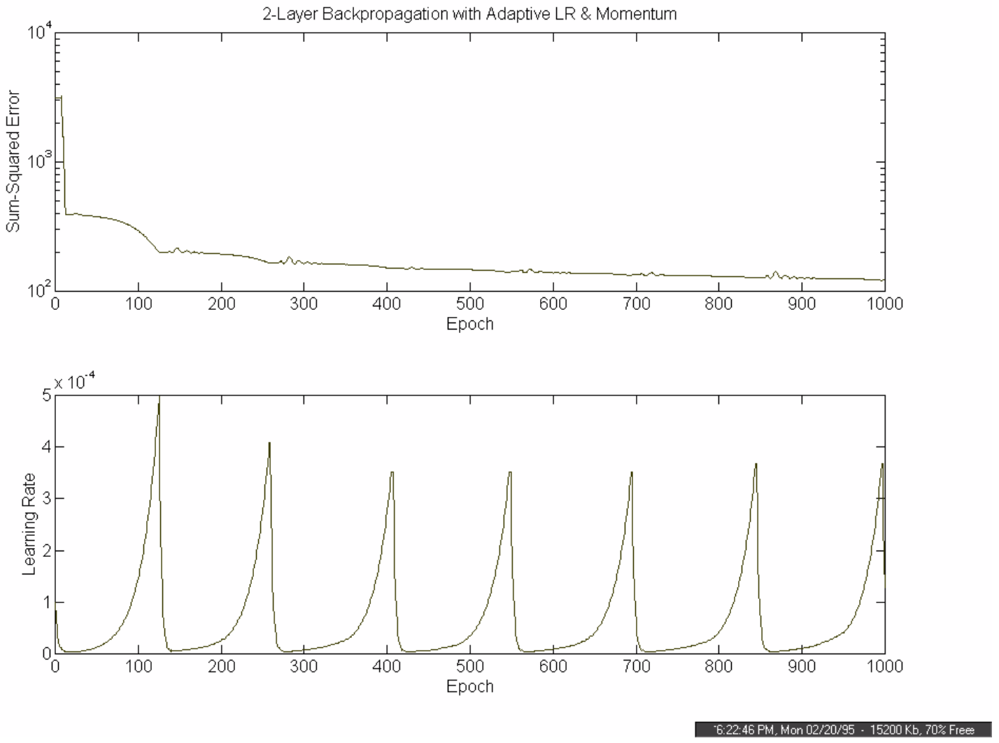
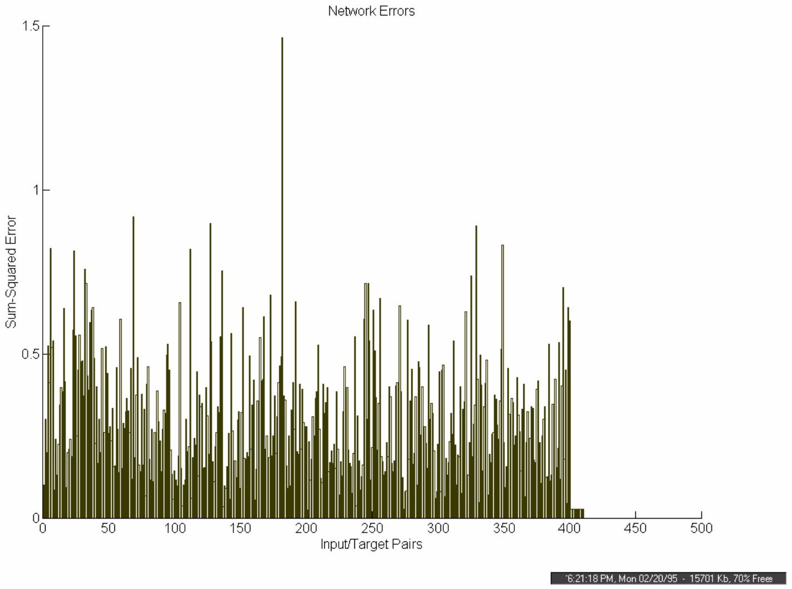

**CHAPTER SIX**

**EXPERIMENTAL RESULTS**

**6.1 Introduction**

This chapter deals with the testing and evaluation of the ASR System. It begins with the testing goals and the control measures used to achieve them. This is followed by a listing of the experimental test results. The confusion matrix format is used to present the recognition rate for each phrase as well as a combined average for all eight phrases. An analysis of the recognition errors is provided in the final section, which evaluates the test results in light of the testing goals.

**6.2 Testing Goals**

One of the goals of testing was to measure the recognition accuracy of the ASR system and determine the how well it performed over a range of conditions, including:

- Speaker dependency (speaker dependent vs. speaker independent),

- Transmission channel (microphone recordings vs. telephone recordings), and

- Feature representation (Bi Formant Ratio Vector vs. Tri Formant Ratio Vector).

It was also desirable to be able to directly assess the contribution of that the Fuzzy ART Map ANN had as the recognition component of the ASR system. To accomplish this, a well-known ANN would be used as a benchmark recognizer and substituted into the ASR system. It would be tested under the same conditions as the ANN it replaced. Finally, an analysis of the recognition errors was needed to identify the strengths and weaknesses of the present system and possibly isolate sources of error to improve system performance in future work. The following paragraphs describe the control measures and test methods used to achieve these goals.

**6.2.1 Testing Control Measures**

To increase confidence in the test results, the tests were designed to be consistent, impartial and as realistic as possible. The following control measures were observed for all tests:

- Only the RMC Speech Database was used as speech material;

- The same training and test sets were used in all tests;

- No overlap of (identical) phrases occurred between the training and test sets;

- Set phrases were chosen chronologically (e.g., training set phrases predate those in test set);

- No phrases were thrown out to improve results; and

- Only the speakers who had recorded a minimum of 40 phrase samples were used for testing.

**6.2.2 Testing Methods**

To satisfy the test goals, the recognition accuracy of the ASR system was tested under every permutation of the three (binary) conditions of interest; namely, speaker dependency, transmission channel and feature representation. This produced a total of eight tests. The benchmark testing (described below) was carried out separately using only microphone recorded speech converted to the BFRV representation. The speaker dependency testing of the benchmark ANN produced an additional two tests. The results of all ten test sessions are presented in section 6.3, after the following description of testing methods.

<u>Speaker Dependency Testing</u>

In speaker dependent testing, only the speech samples from the speaker under test were used to train and test the ASR system. Half of the total recorded samples from the test speaker were used to train the network, while the other half was used to test the network. Because two speakers did not record an even number of sessions, the numbers of test phrases are not uniformly distributed amongst each phrase type. To provide statistically meaningful performance measurements, the test results from each of the eleven speakers have been combined and are presented in one confusion matrix.

In speaker independent testing, each of the speakers contributed five tokens of the eight phrases (numbered 2 through 9). The ASR system was trained on the speech samples from the first ten speakers, for a total of 400 training samples. The 40 phrases from the eleventh speaker were used to test the system. Eleven such tests were conducted by rotating each of the speakers through the test speaker position and training the ASR system using the other ten.

<u>Transmission Channel Testing</u>

The RMC Speech Database, which was batch recorded using a high quality microphone at a sampling rate of 22050 Hz with 16 bit resolution, was used for all microphone channel speech samples.

To assess the ability of the ASR system to perform phrase recognition over real public phone lines, the RMC Speech Database was played into a telephone handset and digitally recorded (on-line) at the other end of a local telephone call using an electromagnetic telephone pickup. A sampling rate of 8000 Hz with 16 bit resolution was used to lower disk space requirements while maintaining a frequency resolution greater than 3300 Hz (the upper limit of the telephone channel). This **telephone filtered** version of the RMC Speech Database was then used for all telephone channel speech samples.

<u>Feature Representation Testing</u>

The effectiveness of the BFRV (Bi Formant Ratio Vector) representation of speech samples is compared to that of the TFRV (Tri Formant Ratio Vector) representation developed in chapter five. This latter representation was discovered late in the testing schedule. Due to time limitations, benchmark testing (described below) using the TFRV representation was left to future work.

<u>Benchmark Testing</u>

A backpropagation trained neural network was selected as the benchmark recognizer used to replace the Fuzzy ART Map component of the ASR system. More precisely, the network was a multi-layer feedforward ANN utilizing the backpropagation learning algorithm augmented by a momentum term and an adaptive learning rate. The network consisted of an input layer of 300 nodes (the size of the BFRV input vector), a hidden layer of 50 nodes (found to provide optimal performance) with a tan-sigmoid activation function, and an output layer of 8 nodes (one for each phrase to be recognized) with a linear activation function.

Nguyen-Widrow initial conditions were used to provide the best hope of achieving a good set of starting weights for the network. Several sets of initial conditions were tested and the set that produced the quickest convergence was kept and used to initialize the network for all training. Due to time constraints, each training session was limited to 1000 cycles (epochs) of the training set. The source code for the ANN programs used to simulate this network is listed in Annex F (BPMAPPER.M) and Annex G (BPTESTER.M).

**6.3 Test Results**

This section presents the experimental results of ten test sessions. The benchmark testing results are presented first, and compare the speaker dependency performance of the backpropagation ANN using only microphone speech samples and the BFRV representation. Table 6.1 gives the speaker dependent results and table 6.2 lists those for the speaker independent test case.

The remaining eight test sessions are performed on the ASR system with the Fuzzy ART Map ANN as the recognizer component. For these last eight sessions, the transmission channel testing results (microphone vs. telephone) are presented side by side to carry on the precedent set in chapter five. Again, the suffix “M” and “T” are used to denote microphone and telephone speech samples respectively. The tables are organized with the BFRV representation results presented first, and the more accurate TFRV representation last, as shown below:

- Tables 6.3-M and 6.3-T BFRV Representation / Speaker Dependent

- Tables 6.4-M and 6.4-T BFRV Representation / Speaker Independent

- Tables 6.5-M and 6.5-T TFRV Representation / Speaker Dependent

- Tables 6.6-M and 6.6-T TFRV Representation / Speaker Independent

The recognition rates for each session are summarized in table 6.7 at the end of the section.

<table style="width:100%;">
<colgroup>
<col style="width: 22%" />
<col style="width: 7%" />
<col style="width: 7%" />
<col style="width: 7%" />
<col style="width: 7%" />
<col style="width: 7%" />
<col style="width: 7%" />
<col style="width: 7%" />
<col style="width: 7%" />
<col style="width: 19%" />
</colgroup>
<tbody>
<tr>
<td style="text-align: center;">
Recognized →

↓Spoken
</td>
<td style="text-align: center;">2</td>
<td style="text-align: center;">3</td>
<td style="text-align: center;">4</td>
<td style="text-align: center;">5</td>
<td style="text-align: center;">6</td>
<td style="text-align: center;">7</td>
<td style="text-align: center;">8</td>
<td style="text-align: center;">9</td>
<td style="text-align: center;">
Recognition

Rate
</td>
</tr>
<tr>
<td style="text-align: center;">2</td>
<td style="text-align: center;"><strong>69</strong></td>
<td style="text-align: center;"></td>
<td style="text-align: center;"><strong>2</strong></td>
<td style="text-align: center;"><strong>1</strong></td>
<td style="text-align: center;"></td>
<td style="text-align: center;"><strong>5</strong></td>
<td style="text-align: center;"></td>
<td style="text-align: center;"></td>
<td style="text-align: center;"><strong>69 / 77</strong></td>
</tr>
<tr>
<td style="text-align: center;">3</td>
<td style="text-align: center;"></td>
<td style="text-align: center;"><strong>76</strong></td>
<td style="text-align: center;"></td>
<td style="text-align: center;"><strong>1</strong></td>
<td style="text-align: center;"></td>
<td style="text-align: center;"></td>
<td style="text-align: center;"></td>
<td style="text-align: center;"></td>
<td style="text-align: center;"><strong>76 / 77</strong></td>
</tr>
<tr>
<td style="text-align: center;">4</td>
<td style="text-align: center;"></td>
<td style="text-align: center;"></td>
<td style="text-align: center;"><strong>74</strong></td>
<td style="text-align: center;"><strong>1</strong></td>
<td style="text-align: center;"><strong>1</strong></td>
<td style="text-align: center;"><strong>1</strong></td>
<td style="text-align: center;"></td>
<td style="text-align: center;"></td>
<td style="text-align: center;"><strong>74 / 77</strong></td>
</tr>
<tr>
<td style="text-align: center;">5</td>
<td style="text-align: center;"></td>
<td style="text-align: center;"></td>
<td style="text-align: center;"><strong>1</strong></td>
<td style="text-align: center;"><strong>72</strong></td>
<td style="text-align: center;"><strong>1</strong></td>
<td style="text-align: center;"><strong>1</strong></td>
<td style="text-align: center;"></td>
<td style="text-align: center;"><strong>2</strong></td>
<td style="text-align: center;"><strong>72 / 77</strong></td>
</tr>
<tr>
<td style="text-align: center;">6</td>
<td style="text-align: center;"><strong>2</strong></td>
<td style="text-align: center;"></td>
<td style="text-align: center;"><strong>3</strong></td>
<td style="text-align: center;"></td>
<td style="text-align: center;"><strong>59</strong></td>
<td style="text-align: center;"><strong>2</strong></td>
<td style="text-align: center;"><strong>5</strong></td>
<td style="text-align: center;"><strong>8</strong></td>
<td style="text-align: center;"><strong>59 / 79</strong></td>
</tr>
<tr>
<td style="text-align: center;">7</td>
<td style="text-align: center;"><strong>2</strong></td>
<td style="text-align: center;"></td>
<td style="text-align: center;"></td>
<td style="text-align: center;"><strong>1</strong></td>
<td style="text-align: center;"></td>
<td style="text-align: center;"><strong>76</strong></td>
<td style="text-align: center;"></td>
<td style="text-align: center;"></td>
<td style="text-align: center;"><strong>76 / 79</strong></td>
</tr>
<tr>
<td style="text-align: center;">8</td>
<td style="text-align: center;"></td>
<td style="text-align: center;"></td>
<td style="text-align: center;"></td>
<td style="text-align: center;"></td>
<td style="text-align: center;"></td>
<td style="text-align: center;"><strong>2</strong></td>
<td style="text-align: center;"><strong>77</strong></td>
<td style="text-align: center;"></td>
<td style="text-align: center;"><strong>77 / 79</strong></td>
</tr>
<tr>
<td style="text-align: center;">9</td>
<td style="text-align: center;"></td>
<td style="text-align: center;"></td>
<td style="text-align: center;"></td>
<td style="text-align: center;"><strong>6</strong></td>
<td style="text-align: center;"><strong>3</strong></td>
<td style="text-align: center;"></td>
<td style="text-align: center;"><strong>1</strong></td>
<td style="text-align: center;"><strong>69</strong></td>
<td style="text-align: center;"><strong>69 / 79</strong></td>
</tr>
<tr>
<td style="text-align: center;">
Total

Output
</td>
<td style="text-align: center;"><strong>73</strong></td>
<td style="text-align: center;"><strong>76</strong></td>
<td style="text-align: center;"><strong>80</strong></td>
<td style="text-align: center;"><strong>82</strong></td>
<td style="text-align: center;"><strong>64</strong></td>
<td style="text-align: center;"><strong>87</strong></td>
<td style="text-align: center;"><strong>83</strong></td>
<td style="text-align: center;"><strong>79</strong></td>
<td style="text-align: center;">
<strong><u>572</u> = 91.7%</strong>

<strong>624</strong>
</td>
</tr>
</tbody>
</table>

**Table 6.1 Benchmark ANN / BFRV / Microphone / Speaker Dependent**

<table style="width:100%;">
<colgroup>
<col style="width: 20%" />
<col style="width: 7%" />
<col style="width: 7%" />
<col style="width: 7%" />
<col style="width: 7%" />
<col style="width: 7%" />
<col style="width: 7%" />
<col style="width: 7%" />
<col style="width: 7%" />
<col style="width: 21%" />
</colgroup>
<tbody>
<tr>
<td style="text-align: center;">
Recognized→

↓Spoken
</td>
<td style="text-align: center;">2</td>
<td style="text-align: center;">3</td>
<td style="text-align: center;">4</td>
<td style="text-align: center;">5</td>
<td style="text-align: center;">6</td>
<td style="text-align: center;">7</td>
<td style="text-align: center;">8</td>
<td style="text-align: center;">9</td>
<td style="text-align: center;">
Recognition

Rate
</td>
</tr>
<tr>
<td style="text-align: center;">2</td>
<td style="text-align: center;"><strong>51</strong></td>
<td style="text-align: center;"></td>
<td style="text-align: center;"><strong>2</strong></td>
<td style="text-align: center;"></td>
<td style="text-align: center;"></td>
<td style="text-align: center;"><strong>1</strong></td>
<td style="text-align: center;"><strong>1</strong></td>
<td style="text-align: center;"></td>
<td style="text-align: center;"><strong>51 / 55</strong></td>
</tr>
<tr>
<td style="text-align: center;">3</td>
<td style="text-align: center;"><strong>1</strong></td>
<td style="text-align: center;"><strong>52</strong></td>
<td style="text-align: center;"></td>
<td style="text-align: center;"></td>
<td style="text-align: center;"></td>
<td style="text-align: center;"></td>
<td style="text-align: center;"><strong>1</strong></td>
<td style="text-align: center;"><strong>1</strong></td>
<td style="text-align: center;"><strong>52 / 55</strong></td>
</tr>
<tr>
<td style="text-align: center;">4</td>
<td style="text-align: center;"></td>
<td style="text-align: center;"><strong>1</strong></td>
<td style="text-align: center;"><strong>52</strong></td>
<td style="text-align: center;"><strong>2</strong></td>
<td style="text-align: center;"></td>
<td style="text-align: center;"></td>
<td style="text-align: center;"></td>
<td style="text-align: center;"></td>
<td style="text-align: center;"><strong>52 / 55</strong></td>
</tr>
<tr>
<td style="text-align: center;">5</td>
<td style="text-align: center;"></td>
<td style="text-align: center;"></td>
<td style="text-align: center;"><strong>1</strong></td>
<td style="text-align: center;"><strong>54</strong></td>
<td style="text-align: center;"></td>
<td style="text-align: center;"></td>
<td style="text-align: center;"></td>
<td style="text-align: center;"></td>
<td style="text-align: center;"><strong>54 / 55</strong></td>
</tr>
<tr>
<td style="text-align: center;">6</td>
<td style="text-align: center;"><strong>1</strong></td>
<td style="text-align: center;"></td>
<td style="text-align: center;"><strong>1</strong></td>
<td style="text-align: center;"></td>
<td style="text-align: center;"><strong>47</strong></td>
<td style="text-align: center;"></td>
<td style="text-align: center;"><strong>3</strong></td>
<td style="text-align: center;"><strong>3</strong></td>
<td style="text-align: center;"><strong>47 / 55</strong></td>
</tr>
<tr>
<td style="text-align: center;">7</td>
<td style="text-align: center;"><strong>2</strong></td>
<td style="text-align: center;"><strong>2</strong></td>
<td style="text-align: center;"></td>
<td style="text-align: center;"></td>
<td style="text-align: center;"></td>
<td style="text-align: center;"><strong>48</strong></td>
<td style="text-align: center;"><strong>2</strong></td>
<td style="text-align: center;"><strong>1</strong></td>
<td style="text-align: center;"><strong>48 / 55</strong></td>
</tr>
<tr>
<td style="text-align: center;">8</td>
<td style="text-align: center;"></td>
<td style="text-align: center;"><strong>1</strong></td>
<td style="text-align: center;"></td>
<td style="text-align: center;"></td>
<td style="text-align: center;"><strong>5</strong></td>
<td style="text-align: center;"><strong>1</strong></td>
<td style="text-align: center;"><strong>46</strong></td>
<td style="text-align: center;"><strong>2</strong></td>
<td style="text-align: center;"><strong>46 / 55</strong></td>
</tr>
<tr>
<td style="text-align: center;">9</td>
<td style="text-align: center;"></td>
<td style="text-align: center;"><strong>4</strong></td>
<td style="text-align: center;"></td>
<td style="text-align: center;"><strong>1</strong></td>
<td style="text-align: center;"><strong>4</strong></td>
<td style="text-align: center;"><strong>3</strong></td>
<td style="text-align: center;"><strong>2</strong></td>
<td style="text-align: center;"><strong>41</strong></td>
<td style="text-align: center;"><strong>41 / 55</strong></td>
</tr>
<tr>
<td style="text-align: center;">
Total

Output
</td>
<td style="text-align: center;"><strong>55</strong></td>
<td style="text-align: center;"><strong>60</strong></td>
<td style="text-align: center;"><strong>56</strong></td>
<td style="text-align: center;"><strong>57</strong></td>
<td style="text-align: center;"><strong>56</strong></td>
<td style="text-align: center;"><strong>53</strong></td>
<td style="text-align: center;"><strong>55</strong></td>
<td style="text-align: center;"><strong>48</strong></td>
<td style="text-align: center;">
<strong><u>391</u> = 88.7 %</strong>

<strong>440</strong>
</td>
</tr>
</tbody>
</table>

**Table 6.2 Benchmark ANN / BFRV / Microphone / Speaker Independent**

<table>
<colgroup>
<col style="width: 22%" />
<col style="width: 7%" />
<col style="width: 7%" />
<col style="width: 7%" />
<col style="width: 7%" />
<col style="width: 7%" />
<col style="width: 7%" />
<col style="width: 7%" />
<col style="width: 7%" />
<col style="width: 19%" />
</colgroup>
<tbody>
<tr>
<td style="text-align: center;">
Recognized →

↓Spoken
</td>
<td style="text-align: center;">2</td>
<td style="text-align: center;">3</td>
<td style="text-align: center;">4</td>
<td style="text-align: center;">5</td>
<td style="text-align: center;">6</td>
<td style="text-align: center;">7</td>
<td style="text-align: center;">8</td>
<td style="text-align: center;">9</td>
<td style="text-align: center;">
Recognition

Rate
</td>
</tr>
<tr>
<td style="text-align: center;">2</td>
<td style="text-align: center;"><strong>76</strong></td>
<td style="text-align: center;"></td>
<td style="text-align: center;"><strong>1</strong></td>
<td style="text-align: center;"></td>
<td style="text-align: center;"></td>
<td style="text-align: center;"></td>
<td style="text-align: center;"></td>
<td style="text-align: center;"></td>
<td style="text-align: center;"><strong>76 / 77</strong></td>
</tr>
<tr>
<td style="text-align: center;">3</td>
<td style="text-align: center;"></td>
<td style="text-align: center;"><strong>76</strong></td>
<td style="text-align: center;"><strong>1</strong></td>
<td style="text-align: center;"></td>
<td style="text-align: center;"></td>
<td style="text-align: center;"></td>
<td style="text-align: center;"></td>
<td style="text-align: center;"></td>
<td style="text-align: center;"><strong>76 / 77</strong></td>
</tr>
<tr>
<td style="text-align: center;">4</td>
<td style="text-align: center;"></td>
<td style="text-align: center;"></td>
<td style="text-align: center;"><strong>77</strong></td>
<td style="text-align: center;"></td>
<td style="text-align: center;"></td>
<td style="text-align: center;"></td>
<td style="text-align: center;"></td>
<td style="text-align: center;"></td>
<td style="text-align: center;"><strong>77 / 77</strong></td>
</tr>
<tr>
<td style="text-align: center;">5</td>
<td style="text-align: center;"></td>
<td style="text-align: center;"></td>
<td style="text-align: center;"></td>
<td style="text-align: center;"><strong>77</strong></td>
<td style="text-align: center;"></td>
<td style="text-align: center;"></td>
<td style="text-align: center;"></td>
<td style="text-align: center;"></td>
<td style="text-align: center;"><strong>77 / 77</strong></td>
</tr>
<tr>
<td style="text-align: center;">6</td>
<td style="text-align: center;"></td>
<td style="text-align: center;"></td>
<td style="text-align: center;"></td>
<td style="text-align: center;"></td>
<td style="text-align: center;"><strong>69</strong></td>
<td style="text-align: center;"></td>
<td style="text-align: center;"><strong>4</strong></td>
<td style="text-align: center;"><strong>6</strong></td>
<td style="text-align: center;"><strong>69 / 79</strong></td>
</tr>
<tr>
<td style="text-align: center;">7</td>
<td style="text-align: center;"></td>
<td style="text-align: center;"><strong>2</strong></td>
<td style="text-align: center;"></td>
<td style="text-align: center;"><strong>1</strong></td>
<td style="text-align: center;"></td>
<td style="text-align: center;"><strong>75</strong></td>
<td style="text-align: center;"><strong>1</strong></td>
<td style="text-align: center;"></td>
<td style="text-align: center;"><strong>75 / 79</strong></td>
</tr>
<tr>
<td style="text-align: center;">8</td>
<td style="text-align: center;"></td>
<td style="text-align: center;"></td>
<td style="text-align: center;"></td>
<td style="text-align: center;"></td>
<td style="text-align: center;"></td>
<td style="text-align: center;"></td>
<td style="text-align: center;"><strong>79</strong></td>
<td style="text-align: center;"></td>
<td style="text-align: center;"><strong>79 / 79</strong></td>
</tr>
<tr>
<td style="text-align: center;">9</td>
<td style="text-align: center;"></td>
<td style="text-align: center;"></td>
<td style="text-align: center;"></td>
<td style="text-align: center;"><strong>2</strong></td>
<td style="text-align: center;"></td>
<td style="text-align: center;"></td>
<td style="text-align: center;"></td>
<td style="text-align: center;"><strong>77</strong></td>
<td style="text-align: center;"><strong>77 / 79</strong></td>
</tr>
<tr>
<td style="text-align: center;">
Total

Output
</td>
<td style="text-align: center;"><strong>76</strong></td>
<td style="text-align: center;"><strong>78</strong></td>
<td style="text-align: center;"><strong>79</strong></td>
<td style="text-align: center;"><strong>80</strong></td>
<td style="text-align: center;"><strong>69</strong></td>
<td style="text-align: center;"><strong>75</strong></td>
<td style="text-align: center;"><strong>84</strong></td>
<td style="text-align: center;"><strong>83</strong></td>
<td style="text-align: center;">
<strong><u>606</u> = 97.1%</strong>

<strong>624</strong>
</td>
</tr>
</tbody>
</table>

**Table 6.3-M Fuzzy ART Map / BFRV / Speaker Dependent / Microphone**

<table style="width:100%;">
<colgroup>
<col style="width: 22%" />
<col style="width: 7%" />
<col style="width: 7%" />
<col style="width: 7%" />
<col style="width: 7%" />
<col style="width: 7%" />
<col style="width: 7%" />
<col style="width: 7%" />
<col style="width: 7%" />
<col style="width: 19%" />
</colgroup>
<tbody>
<tr>
<td style="text-align: center;">
Recognized →

↓Spoken
</td>
<td style="text-align: center;">2</td>
<td style="text-align: center;">3</td>
<td style="text-align: center;">4</td>
<td style="text-align: center;">5</td>
<td style="text-align: center;">6</td>
<td style="text-align: center;">7</td>
<td style="text-align: center;">8</td>
<td style="text-align: center;">9</td>
<td style="text-align: center;">
Recognition

Rate
</td>
</tr>
<tr>
<td style="text-align: center;">2</td>
<td style="text-align: center;"><strong>71</strong></td>
<td style="text-align: center;"></td>
<td style="text-align: center;"><strong>1</strong></td>
<td style="text-align: center;"></td>
<td style="text-align: center;"></td>
<td style="text-align: center;"><strong>3</strong></td>
<td style="text-align: center;"><strong>1</strong></td>
<td style="text-align: center;"><strong>1</strong></td>
<td style="text-align: center;"><strong>71/77</strong></td>
</tr>
<tr>
<td style="text-align: center;">3</td>
<td style="text-align: center;"><strong>1</strong></td>
<td style="text-align: center;"><strong>73</strong></td>
<td style="text-align: center;"><strong>1</strong></td>
<td style="text-align: center;"><strong>1</strong></td>
<td style="text-align: center;"></td>
<td style="text-align: center;"></td>
<td style="text-align: center;"></td>
<td style="text-align: center;"><strong>1</strong></td>
<td style="text-align: center;"><strong>73/77</strong></td>
</tr>
<tr>
<td style="text-align: center;">4</td>
<td style="text-align: center;"></td>
<td style="text-align: center;"></td>
<td style="text-align: center;"><strong>75</strong></td>
<td style="text-align: center;"></td>
<td style="text-align: center;"><strong>1</strong></td>
<td style="text-align: center;"></td>
<td style="text-align: center;"></td>
<td style="text-align: center;"><strong>1</strong></td>
<td style="text-align: center;"><strong>75/77</strong></td>
</tr>
<tr>
<td style="text-align: center;">5</td>
<td style="text-align: center;"></td>
<td style="text-align: center;"><strong>2</strong></td>
<td style="text-align: center;"></td>
<td style="text-align: center;"><strong>74</strong></td>
<td style="text-align: center;"><strong>1</strong></td>
<td style="text-align: center;"></td>
<td style="text-align: center;"></td>
<td style="text-align: center;"></td>
<td style="text-align: center;"><strong>74/77</strong></td>
</tr>
<tr>
<td style="text-align: center;">6</td>
<td style="text-align: center;"><strong>1</strong></td>
<td style="text-align: center;"></td>
<td style="text-align: center;"><strong>1</strong></td>
<td style="text-align: center;"><strong>2</strong></td>
<td style="text-align: center;"><strong>59</strong></td>
<td style="text-align: center;"></td>
<td style="text-align: center;"><strong>12</strong></td>
<td style="text-align: center;"><strong>4</strong></td>
<td style="text-align: center;"><strong>59/79</strong></td>
</tr>
<tr>
<td style="text-align: center;">7</td>
<td style="text-align: center;"><strong>2</strong></td>
<td style="text-align: center;"><strong>2</strong></td>
<td style="text-align: center;"></td>
<td style="text-align: center;"><strong>3</strong></td>
<td style="text-align: center;"><strong>2</strong></td>
<td style="text-align: center;"><strong>64</strong></td>
<td style="text-align: center;"><strong>1</strong></td>
<td style="text-align: center;"><strong>5</strong></td>
<td style="text-align: center;"><strong>64/79</strong></td>
</tr>
<tr>
<td style="text-align: center;">8</td>
<td style="text-align: center;"><strong>1</strong></td>
<td style="text-align: center;"></td>
<td style="text-align: center;"></td>
<td style="text-align: center;"></td>
<td style="text-align: center;"><strong>2</strong></td>
<td style="text-align: center;"><strong>1</strong></td>
<td style="text-align: center;"><strong>75</strong></td>
<td style="text-align: center;"></td>
<td style="text-align: center;"><strong>75/79</strong></td>
</tr>
<tr>
<td style="text-align: center;">9</td>
<td style="text-align: center;"><strong>1</strong></td>
<td style="text-align: center;"><strong>4</strong></td>
<td style="text-align: center;"></td>
<td style="text-align: center;"><strong>3</strong></td>
<td style="text-align: center;"><strong>5</strong></td>
<td style="text-align: center;"></td>
<td style="text-align: center;"><strong>8</strong></td>
<td style="text-align: center;"><strong>58</strong></td>
<td style="text-align: center;"><strong>58/79</strong></td>
</tr>
<tr>
<td style="text-align: center;">
Total

Output
</td>
<td style="text-align: center;"><strong>77</strong></td>
<td style="text-align: center;"><strong>81</strong></td>
<td style="text-align: center;"><strong>78</strong></td>
<td style="text-align: center;"><strong>83</strong></td>
<td style="text-align: center;"><strong>70</strong></td>
<td style="text-align: center;"><strong>68</strong></td>
<td style="text-align: center;"><strong>97</strong></td>
<td style="text-align: center;"><strong>70</strong></td>
<td style="text-align: center;">
<strong><u>549</u> = 88.0%</strong>

<strong>624</strong>
</td>
</tr>
</tbody>
</table>

**Table 6.3-T Fuzzy ART Map / BFRV / Speaker Dependent / Telephone**

<table>
<colgroup>
<col style="width: 20%" />
<col style="width: 7%" />
<col style="width: 7%" />
<col style="width: 7%" />
<col style="width: 7%" />
<col style="width: 7%" />
<col style="width: 7%" />
<col style="width: 7%" />
<col style="width: 7%" />
<col style="width: 20%" />
</colgroup>
<tbody>
<tr>
<td style="text-align: center;">
Recognized→

↓Spoken
</td>
<td style="text-align: center;">2</td>
<td style="text-align: center;">3</td>
<td style="text-align: center;">4</td>
<td style="text-align: center;">5</td>
<td style="text-align: center;">6</td>
<td style="text-align: center;">7</td>
<td style="text-align: center;">8</td>
<td style="text-align: center;">9</td>
<td style="text-align: center;">
Recognition

Rate
</td>
</tr>
<tr>
<td style="text-align: center;">2</td>
<td style="text-align: center;"><strong>54</strong></td>
<td style="text-align: center;"></td>
<td style="text-align: center;"></td>
<td style="text-align: center;"></td>
<td style="text-align: center;"></td>
<td style="text-align: center;"></td>
<td style="text-align: center;"></td>
<td style="text-align: center;"><strong>1</strong></td>
<td style="text-align: center;"><strong>54 / 55</strong></td>
</tr>
<tr>
<td style="text-align: center;">3</td>
<td style="text-align: center;"><strong>1</strong></td>
<td style="text-align: center;"><strong>54</strong></td>
<td style="text-align: center;"></td>
<td style="text-align: center;"></td>
<td style="text-align: center;"></td>
<td style="text-align: center;"></td>
<td style="text-align: center;"></td>
<td style="text-align: center;"></td>
<td style="text-align: center;"><strong>54 / 55</strong></td>
</tr>
<tr>
<td style="text-align: center;">4</td>
<td style="text-align: center;"></td>
<td style="text-align: center;"></td>
<td style="text-align: center;"><strong>53</strong></td>
<td style="text-align: center;"><strong>2</strong></td>
<td style="text-align: center;"></td>
<td style="text-align: center;"></td>
<td style="text-align: center;"></td>
<td style="text-align: center;"></td>
<td style="text-align: center;"><strong>53 / 55</strong></td>
</tr>
<tr>
<td style="text-align: center;">5</td>
<td style="text-align: center;"></td>
<td style="text-align: center;"></td>
<td style="text-align: center;"></td>
<td style="text-align: center;"><strong>55</strong></td>
<td style="text-align: center;"></td>
<td style="text-align: center;"></td>
<td style="text-align: center;"></td>
<td style="text-align: center;"></td>
<td style="text-align: center;"><strong>55 / 55</strong></td>
</tr>
<tr>
<td style="text-align: center;">6</td>
<td style="text-align: center;"></td>
<td style="text-align: center;"></td>
<td style="text-align: center;"></td>
<td style="text-align: center;"><strong>2</strong></td>
<td style="text-align: center;"><strong>47</strong></td>
<td style="text-align: center;"></td>
<td style="text-align: center;"><strong>4</strong></td>
<td style="text-align: center;"><strong>2</strong></td>
<td style="text-align: center;"><strong>47 / 55</strong></td>
</tr>
<tr>
<td style="text-align: center;">7</td>
<td style="text-align: center;"></td>
<td style="text-align: center;"></td>
<td style="text-align: center;"></td>
<td style="text-align: center;"></td>
<td style="text-align: center;"><strong>1</strong></td>
<td style="text-align: center;"><strong>48</strong></td>
<td style="text-align: center;"><strong>2</strong></td>
<td style="text-align: center;"><strong>4</strong></td>
<td style="text-align: center;"><strong>48 / 55</strong></td>
</tr>
<tr>
<td style="text-align: center;">8</td>
<td style="text-align: center;"></td>
<td style="text-align: center;"></td>
<td style="text-align: center;"></td>
<td style="text-align: center;"></td>
<td style="text-align: center;"></td>
<td style="text-align: center;"></td>
<td style="text-align: center;"><strong>51</strong></td>
<td style="text-align: center;"><strong>4</strong></td>
<td style="text-align: center;"><strong>51 / 55</strong></td>
</tr>
<tr>
<td style="text-align: center;">9</td>
<td style="text-align: center;"></td>
<td style="text-align: center;"></td>
<td style="text-align: center;"></td>
<td style="text-align: center;"></td>
<td style="text-align: center;"><strong>1</strong></td>
<td style="text-align: center;"><strong>1</strong></td>
<td style="text-align: center;"><strong>2</strong></td>
<td style="text-align: center;"><strong>51</strong></td>
<td style="text-align: center;"><strong>51 / 55</strong></td>
</tr>
<tr>
<td style="text-align: center;">
Total

Output
</td>
<td style="text-align: center;"><strong>55</strong></td>
<td style="text-align: center;"><strong>54</strong></td>
<td style="text-align: center;"><strong>53</strong></td>
<td style="text-align: center;"><strong>59</strong></td>
<td style="text-align: center;"><strong>49</strong></td>
<td style="text-align: center;"><strong>49</strong></td>
<td style="text-align: center;"><strong>60</strong></td>
<td style="text-align: center;"><strong>61</strong></td>
<td style="text-align: center;">
<strong><u>414</u> = 94.1%</strong>

<strong>440</strong>
</td>
</tr>
</tbody>
</table>

**Table 6.4-M Fuzzy ART Map / BFRV / Speaker Independent / Microphone**

<table>
<colgroup>
<col style="width: 20%" />
<col style="width: 7%" />
<col style="width: 7%" />
<col style="width: 7%" />
<col style="width: 7%" />
<col style="width: 7%" />
<col style="width: 7%" />
<col style="width: 7%" />
<col style="width: 7%" />
<col style="width: 20%" />
</colgroup>
<tbody>
<tr>
<td style="text-align: center;">
Recognized→

↓Spoken
</td>
<td style="text-align: center;">2</td>
<td style="text-align: center;">3</td>
<td style="text-align: center;">4</td>
<td style="text-align: center;">5</td>
<td style="text-align: center;">6</td>
<td style="text-align: center;">7</td>
<td style="text-align: center;">8</td>
<td style="text-align: center;">9</td>
<td style="text-align: center;">
Recognition

Rate
</td>
</tr>
<tr>
<td style="text-align: center;">2</td>
<td style="text-align: center;"><strong>46</strong></td>
<td style="text-align: center;"></td>
<td style="text-align: center;"><strong>1</strong></td>
<td style="text-align: center;"></td>
<td style="text-align: center;"></td>
<td style="text-align: center;"><strong>6</strong></td>
<td style="text-align: center;"><strong>2</strong></td>
<td style="text-align: center;"></td>
<td style="text-align: center;"><strong>46 / 55</strong></td>
</tr>
<tr>
<td style="text-align: center;">3</td>
<td style="text-align: center;"></td>
<td style="text-align: center;"><strong>52</strong></td>
<td style="text-align: center;"></td>
<td style="text-align: center;"><strong>2</strong></td>
<td style="text-align: center;"></td>
<td style="text-align: center;"></td>
<td style="text-align: center;"></td>
<td style="text-align: center;"><strong>1</strong></td>
<td style="text-align: center;"><strong>52 / 55</strong></td>
</tr>
<tr>
<td style="text-align: center;">4</td>
<td style="text-align: center;"><strong>2</strong></td>
<td style="text-align: center;"></td>
<td style="text-align: center;"><strong>49</strong></td>
<td style="text-align: center;"><strong>1</strong></td>
<td style="text-align: center;"></td>
<td style="text-align: center;"><strong>3</strong></td>
<td style="text-align: center;"></td>
<td style="text-align: center;"></td>
<td style="text-align: center;"><strong>49 / 55</strong></td>
</tr>
<tr>
<td style="text-align: center;">5</td>
<td style="text-align: center;"></td>
<td style="text-align: center;"></td>
<td style="text-align: center;"><strong>1</strong></td>
<td style="text-align: center;"><strong>53</strong></td>
<td style="text-align: center;"></td>
<td style="text-align: center;"></td>
<td style="text-align: center;"></td>
<td style="text-align: center;"><strong>1</strong></td>
<td style="text-align: center;"><strong>53 / 55</strong></td>
</tr>
<tr>
<td style="text-align: center;">6</td>
<td style="text-align: center;"></td>
<td style="text-align: center;"></td>
<td style="text-align: center;"></td>
<td style="text-align: center;"><strong>1</strong></td>
<td style="text-align: center;"><strong>34</strong></td>
<td style="text-align: center;"><strong>3</strong></td>
<td style="text-align: center;"><strong>12</strong></td>
<td style="text-align: center;"><strong>5</strong></td>
<td style="text-align: center;"><strong>34 / 55</strong></td>
</tr>
<tr>
<td style="text-align: center;">7</td>
<td style="text-align: center;"><strong>3</strong></td>
<td style="text-align: center;"><strong>1</strong></td>
<td style="text-align: center;"></td>
<td style="text-align: center;"></td>
<td style="text-align: center;"><strong>1</strong></td>
<td style="text-align: center;"><strong>45</strong></td>
<td style="text-align: center;"><strong>2</strong></td>
<td style="text-align: center;"><strong>3</strong></td>
<td style="text-align: center;"><strong>45 / 55</strong></td>
</tr>
<tr>
<td style="text-align: center;">8</td>
<td style="text-align: center;"></td>
<td style="text-align: center;"></td>
<td style="text-align: center;"><strong>1</strong></td>
<td style="text-align: center;"></td>
<td style="text-align: center;"><strong>1</strong></td>
<td style="text-align: center;"></td>
<td style="text-align: center;"><strong>52</strong></td>
<td style="text-align: center;"><strong>1</strong></td>
<td style="text-align: center;"><strong>52 / 55</strong></td>
</tr>
<tr>
<td style="text-align: center;">9</td>
<td style="text-align: center;"></td>
<td style="text-align: center;"><strong>1</strong></td>
<td style="text-align: center;"></td>
<td style="text-align: center;"><strong>3</strong></td>
<td style="text-align: center;"><strong>2</strong></td>
<td style="text-align: center;"><strong>1</strong></td>
<td style="text-align: center;"><strong>4</strong></td>
<td style="text-align: center;"><strong>44</strong></td>
<td style="text-align: center;"><strong>44 / 55</strong></td>
</tr>
<tr>
<td style="text-align: center;">
Total

Output
</td>
<td style="text-align: center;"><strong>51</strong></td>
<td style="text-align: center;"><strong>54</strong></td>
<td style="text-align: center;"><strong>52</strong></td>
<td style="text-align: center;"><strong>60</strong></td>
<td style="text-align: center;"><strong>38</strong></td>
<td style="text-align: center;"><strong>58</strong></td>
<td style="text-align: center;"><strong>72</strong></td>
<td style="text-align: center;"><strong>55</strong></td>
<td style="text-align: center;">
<strong><u>375</u> = 85.2%</strong>

<strong>440</strong>
</td>
</tr>
</tbody>
</table>

**Table 6.4-T Fuzzy ART Map / BFRV / Speaker Independent / Telephone**

<table style="width:100%;">
<colgroup>
<col style="width: 22%" />
<col style="width: 7%" />
<col style="width: 7%" />
<col style="width: 7%" />
<col style="width: 7%" />
<col style="width: 7%" />
<col style="width: 7%" />
<col style="width: 7%" />
<col style="width: 7%" />
<col style="width: 19%" />
</colgroup>
<tbody>
<tr>
<td style="text-align: center;">
Recognized →

↓Spoken
</td>
<td style="text-align: center;">2</td>
<td style="text-align: center;">3</td>
<td style="text-align: center;">4</td>
<td style="text-align: center;">5</td>
<td style="text-align: center;">6</td>
<td style="text-align: center;">7</td>
<td style="text-align: center;">8</td>
<td style="text-align: center;">9</td>
<td style="text-align: center;">
Recognition

Rate
</td>
</tr>
<tr>
<td style="text-align: center;">2</td>
<td style="text-align: center;"><strong>77</strong></td>
<td style="text-align: center;"></td>
<td style="text-align: center;"></td>
<td style="text-align: center;"></td>
<td style="text-align: center;"></td>
<td style="text-align: center;"></td>
<td style="text-align: center;"></td>
<td style="text-align: center;"></td>
<td style="text-align: center;"><strong>77 / 77</strong></td>
</tr>
<tr>
<td style="text-align: center;">3</td>
<td style="text-align: center;"></td>
<td style="text-align: center;"><strong>76</strong></td>
<td style="text-align: center;"><strong>1</strong></td>
<td style="text-align: center;"></td>
<td style="text-align: center;"></td>
<td style="text-align: center;"></td>
<td style="text-align: center;"></td>
<td style="text-align: center;"></td>
<td style="text-align: center;"><strong>76 / 77</strong></td>
</tr>
<tr>
<td style="text-align: center;">4</td>
<td style="text-align: center;"></td>
<td style="text-align: center;"></td>
<td style="text-align: center;"><strong>77</strong></td>
<td style="text-align: center;"></td>
<td style="text-align: center;"></td>
<td style="text-align: center;"></td>
<td style="text-align: center;"></td>
<td style="text-align: center;"></td>
<td style="text-align: center;"><strong>77 / 77</strong></td>
</tr>
<tr>
<td style="text-align: center;">5</td>
<td style="text-align: center;"></td>
<td style="text-align: center;"></td>
<td style="text-align: center;"></td>
<td style="text-align: center;"><strong>77</strong></td>
<td style="text-align: center;"></td>
<td style="text-align: center;"></td>
<td style="text-align: center;"></td>
<td style="text-align: center;"></td>
<td style="text-align: center;"><strong>77 / 77</strong></td>
</tr>
<tr>
<td style="text-align: center;">6</td>
<td style="text-align: center;"></td>
<td style="text-align: center;"></td>
<td style="text-align: center;"></td>
<td style="text-align: center;"></td>
<td style="text-align: center;"><strong>74</strong></td>
<td style="text-align: center;"></td>
<td style="text-align: center;"><strong>3</strong></td>
<td style="text-align: center;"><strong>2</strong></td>
<td style="text-align: center;"><strong>74 / 79</strong></td>
</tr>
<tr>
<td style="text-align: center;">7</td>
<td style="text-align: center;"><strong>1</strong></td>
<td style="text-align: center;"><strong>1</strong></td>
<td style="text-align: center;"></td>
<td style="text-align: center;"><strong>1</strong></td>
<td style="text-align: center;"></td>
<td style="text-align: center;"><strong>75</strong></td>
<td style="text-align: center;"></td>
<td style="text-align: center;"><strong>1</strong></td>
<td style="text-align: center;"><strong>75 / 79</strong></td>
</tr>
<tr>
<td style="text-align: center;">8</td>
<td style="text-align: center;"></td>
<td style="text-align: center;"></td>
<td style="text-align: center;"></td>
<td style="text-align: center;"></td>
<td style="text-align: center;"></td>
<td style="text-align: center;"></td>
<td style="text-align: center;"><strong>79</strong></td>
<td style="text-align: center;"></td>
<td style="text-align: center;"><strong>79 / 79</strong></td>
</tr>
<tr>
<td style="text-align: center;">9</td>
<td style="text-align: center;"></td>
<td style="text-align: center;"></td>
<td style="text-align: center;"></td>
<td style="text-align: center;"><strong>1</strong></td>
<td style="text-align: center;"></td>
<td style="text-align: center;"></td>
<td style="text-align: center;"></td>
<td style="text-align: center;"><strong>78</strong></td>
<td style="text-align: center;"><strong>78 / 79</strong></td>
</tr>
<tr>
<td style="text-align: center;">
Total

Output
</td>
<td style="text-align: center;"><strong>78</strong></td>
<td style="text-align: center;"><strong>77</strong></td>
<td style="text-align: center;"><strong>78</strong></td>
<td style="text-align: center;"><strong>79</strong></td>
<td style="text-align: center;"><strong>74</strong></td>
<td style="text-align: center;"><strong>75</strong></td>
<td style="text-align: center;"><strong>82</strong></td>
<td style="text-align: center;"><strong>81</strong></td>
<td style="text-align: center;">
<strong><u>613</u> = 98.2%</strong>

<strong>624</strong>
</td>
</tr>
</tbody>
</table>

**Table 6.5-M Fuzzy ART Map / TFRV / Speaker Dependent / Microphone**

<table style="width:100%;">
<colgroup>
<col style="width: 22%" />
<col style="width: 7%" />
<col style="width: 7%" />
<col style="width: 7%" />
<col style="width: 7%" />
<col style="width: 7%" />
<col style="width: 7%" />
<col style="width: 7%" />
<col style="width: 7%" />
<col style="width: 19%" />
</colgroup>
<tbody>
<tr>
<td style="text-align: center;">
Recognized →

↓Spoken
</td>
<td style="text-align: center;">2</td>
<td style="text-align: center;">3</td>
<td style="text-align: center;">4</td>
<td style="text-align: center;">5</td>
<td style="text-align: center;">6</td>
<td style="text-align: center;">7</td>
<td style="text-align: center;">8</td>
<td style="text-align: center;">9</td>
<td style="text-align: center;">
Recognition

Rate
</td>
</tr>
<tr>
<td style="text-align: center;">2</td>
<td style="text-align: center;"><strong>73</strong></td>
<td style="text-align: center;"></td>
<td style="text-align: center;"><strong>1</strong></td>
<td style="text-align: center;"></td>
<td style="text-align: center;"></td>
<td style="text-align: center;"><strong>2</strong></td>
<td style="text-align: center;"></td>
<td style="text-align: center;"><strong>1</strong></td>
<td style="text-align: center;"><strong>73 / 77</strong></td>
</tr>
<tr>
<td style="text-align: center;">3</td>
<td style="text-align: center;"></td>
<td style="text-align: center;"><strong>75</strong></td>
<td style="text-align: center;"><strong>1</strong></td>
<td style="text-align: center;"><strong>1</strong></td>
<td style="text-align: center;"></td>
<td style="text-align: center;"></td>
<td style="text-align: center;"></td>
<td style="text-align: center;"></td>
<td style="text-align: center;"><strong>75 / 77</strong></td>
</tr>
<tr>
<td style="text-align: center;">4</td>
<td style="text-align: center;"></td>
<td style="text-align: center;"><strong>1</strong></td>
<td style="text-align: center;"><strong>75</strong></td>
<td style="text-align: center;"><strong>1</strong></td>
<td style="text-align: center;"></td>
<td style="text-align: center;"></td>
<td style="text-align: center;"></td>
<td style="text-align: center;"></td>
<td style="text-align: center;"><strong>75 / 77</strong></td>
</tr>
<tr>
<td style="text-align: center;">5</td>
<td style="text-align: center;"></td>
<td style="text-align: center;"><strong>1</strong></td>
<td style="text-align: center;"></td>
<td style="text-align: center;"><strong>76</strong></td>
<td style="text-align: center;"></td>
<td style="text-align: center;"></td>
<td style="text-align: center;"></td>
<td style="text-align: center;"></td>
<td style="text-align: center;"><strong>76 / 77</strong></td>
</tr>
<tr>
<td style="text-align: center;">6</td>
<td style="text-align: center;"><strong>1</strong></td>
<td style="text-align: center;"></td>
<td style="text-align: center;"></td>
<td style="text-align: center;"><strong>1</strong></td>
<td style="text-align: center;"><strong>66</strong></td>
<td style="text-align: center;"></td>
<td style="text-align: center;"><strong>6</strong></td>
<td style="text-align: center;"><strong>5</strong></td>
<td style="text-align: center;"><strong>66 / 79</strong></td>
</tr>
<tr>
<td style="text-align: center;">7</td>
<td style="text-align: center;"><strong>1</strong></td>
<td style="text-align: center;"><strong>2</strong></td>
<td style="text-align: center;"></td>
<td style="text-align: center;"><strong>4</strong></td>
<td style="text-align: center;"><strong>1</strong></td>
<td style="text-align: center;"><strong>67</strong></td>
<td style="text-align: center;"><strong>1</strong></td>
<td style="text-align: center;"><strong>3</strong></td>
<td style="text-align: center;"><strong>67 / 79</strong></td>
</tr>
<tr>
<td style="text-align: center;">8</td>
<td style="text-align: center;"></td>
<td style="text-align: center;"><strong>1</strong></td>
<td style="text-align: center;"></td>
<td style="text-align: center;"></td>
<td style="text-align: center;"><strong>1</strong></td>
<td style="text-align: center;"><strong>2</strong></td>
<td style="text-align: center;"><strong>75</strong></td>
<td style="text-align: center;"></td>
<td style="text-align: center;"><strong>75 / 79</strong></td>
</tr>
<tr>
<td style="text-align: center;">9</td>
<td style="text-align: center;"><strong>1</strong></td>
<td style="text-align: center;"><strong>3</strong></td>
<td style="text-align: center;"></td>
<td style="text-align: center;"><strong>1</strong></td>
<td style="text-align: center;"><strong>5</strong></td>
<td style="text-align: center;"></td>
<td style="text-align: center;"><strong>5</strong></td>
<td style="text-align: center;"><strong>64</strong></td>
<td style="text-align: center;"><strong>64 / 79</strong></td>
</tr>
<tr>
<td style="text-align: center;">
Total

Output
</td>
<td style="text-align: center;"><strong>76</strong></td>
<td style="text-align: center;"><strong>83</strong></td>
<td style="text-align: center;"><strong>77</strong></td>
<td style="text-align: center;"><strong>84</strong></td>
<td style="text-align: center;"><strong>73</strong></td>
<td style="text-align: center;"><strong>71</strong></td>
<td style="text-align: center;"><strong>87</strong></td>
<td style="text-align: center;"><strong>73</strong></td>
<td style="text-align: center;">
<strong><u>571</u> = 91.5%</strong>

<strong>624</strong>
</td>
</tr>
</tbody>
</table>

**Table 6.5-T Fuzzy ART Map / TFRV / Speaker Dependent / Telephone**

<table style="width:100%;">
<colgroup>
<col style="width: 20%" />
<col style="width: 7%" />
<col style="width: 7%" />
<col style="width: 7%" />
<col style="width: 7%" />
<col style="width: 7%" />
<col style="width: 7%" />
<col style="width: 7%" />
<col style="width: 7%" />
<col style="width: 20%" />
</colgroup>
<tbody>
<tr>
<td style="text-align: center;">
Recognized→

↓Spoken
</td>
<td style="text-align: center;">2</td>
<td style="text-align: center;">3</td>
<td style="text-align: center;">4</td>
<td style="text-align: center;">5</td>
<td style="text-align: center;">6</td>
<td style="text-align: center;">7</td>
<td style="text-align: center;">8</td>
<td style="text-align: center;">9</td>
<td style="text-align: center;">
Recognition

Rate
</td>
</tr>
<tr>
<td style="text-align: center;">2</td>
<td style="text-align: center;"><strong>52</strong></td>
<td style="text-align: center;"><strong>2</strong></td>
<td style="text-align: center;"></td>
<td style="text-align: center;"></td>
<td style="text-align: center;"></td>
<td style="text-align: center;"></td>
<td style="text-align: center;"></td>
<td style="text-align: center;"><strong>1</strong></td>
<td style="text-align: center;"><strong>52 / 55</strong></td>
</tr>
<tr>
<td style="text-align: center;">3</td>
<td style="text-align: center;"><strong>1</strong></td>
<td style="text-align: center;"><strong>54</strong></td>
<td style="text-align: center;"></td>
<td style="text-align: center;"></td>
<td style="text-align: center;"></td>
<td style="text-align: center;"></td>
<td style="text-align: center;"></td>
<td style="text-align: center;"></td>
<td style="text-align: center;"><strong>54 / 55</strong></td>
</tr>
<tr>
<td style="text-align: center;">4</td>
<td style="text-align: center;"></td>
<td style="text-align: center;"></td>
<td style="text-align: center;"><strong>53</strong></td>
<td style="text-align: center;"><strong>2</strong></td>
<td style="text-align: center;"></td>
<td style="text-align: center;"></td>
<td style="text-align: center;"></td>
<td style="text-align: center;"></td>
<td style="text-align: center;"><strong>53 / 55</strong></td>
</tr>
<tr>
<td style="text-align: center;">5</td>
<td style="text-align: center;"></td>
<td style="text-align: center;"></td>
<td style="text-align: center;"></td>
<td style="text-align: center;"><strong>55</strong></td>
<td style="text-align: center;"></td>
<td style="text-align: center;"></td>
<td style="text-align: center;"></td>
<td style="text-align: center;"></td>
<td style="text-align: center;"><strong>55 / 55</strong></td>
</tr>
<tr>
<td style="text-align: center;">6</td>
<td style="text-align: center;"></td>
<td style="text-align: center;"></td>
<td style="text-align: center;"></td>
<td style="text-align: center;"></td>
<td style="text-align: center;"><strong>49</strong></td>
<td style="text-align: center;"><strong>1</strong></td>
<td style="text-align: center;"><strong>2</strong></td>
<td style="text-align: center;"><strong>3</strong></td>
<td style="text-align: center;"><strong>49 / 55</strong></td>
</tr>
<tr>
<td style="text-align: center;">7</td>
<td style="text-align: center;"></td>
<td style="text-align: center;"></td>
<td style="text-align: center;"></td>
<td style="text-align: center;"></td>
<td style="text-align: center;"><strong>1</strong></td>
<td style="text-align: center;"><strong>48</strong></td>
<td style="text-align: center;"><strong>1</strong></td>
<td style="text-align: center;"><strong>5</strong></td>
<td style="text-align: center;"><strong>48 / 55</strong></td>
</tr>
<tr>
<td style="text-align: center;">8</td>
<td style="text-align: center;"></td>
<td style="text-align: center;"></td>
<td style="text-align: center;"></td>
<td style="text-align: center;"></td>
<td style="text-align: center;"><strong>1</strong></td>
<td style="text-align: center;"></td>
<td style="text-align: center;"><strong>51</strong></td>
<td style="text-align: center;"><strong>3</strong></td>
<td style="text-align: center;"><strong>51 / 55</strong></td>
</tr>
<tr>
<td style="text-align: center;">9</td>
<td style="text-align: center;"></td>
<td style="text-align: center;"></td>
<td style="text-align: center;"></td>
<td style="text-align: center;"></td>
<td style="text-align: center;"><strong>1</strong></td>
<td style="text-align: center;"></td>
<td style="text-align: center;"><strong>2</strong></td>
<td style="text-align: center;"><strong>52</strong></td>
<td style="text-align: center;"><strong>52 / 55</strong></td>
</tr>
<tr>
<td style="text-align: center;">
Total

Output
</td>
<td style="text-align: center;"><strong>53</strong></td>
<td style="text-align: center;"><strong>56</strong></td>
<td style="text-align: center;"><strong>53</strong></td>
<td style="text-align: center;"><strong>57</strong></td>
<td style="text-align: center;"><strong>52</strong></td>
<td style="text-align: center;"><strong>49</strong></td>
<td style="text-align: center;"><strong>56</strong></td>
<td style="text-align: center;"><strong>64</strong></td>
<td style="text-align: center;">
<strong><u>414</u> = 94.1%</strong>

<strong>440</strong>
</td>
</tr>
</tbody>
</table>

**Table 6.6-M Fuzzy ART Map / TFRV / Speaker Independent / Microphone**

<table>
<colgroup>
<col style="width: 20%" />
<col style="width: 7%" />
<col style="width: 7%" />
<col style="width: 7%" />
<col style="width: 7%" />
<col style="width: 7%" />
<col style="width: 7%" />
<col style="width: 7%" />
<col style="width: 7%" />
<col style="width: 20%" />
</colgroup>
<tbody>
<tr>
<td style="text-align: center;">
Recognized→

↓Spoken
</td>
<td style="text-align: center;">2</td>
<td style="text-align: center;">3</td>
<td style="text-align: center;">4</td>
<td style="text-align: center;">5</td>
<td style="text-align: center;">6</td>
<td style="text-align: center;">7</td>
<td style="text-align: center;">8</td>
<td style="text-align: center;">9</td>
<td style="text-align: center;">
Recognition

Rate
</td>
</tr>
<tr>
<td style="text-align: center;">2</td>
<td style="text-align: center;"><strong>43</strong></td>
<td style="text-align: center;"></td>
<td style="text-align: center;"><strong>1</strong></td>
<td style="text-align: center;"></td>
<td style="text-align: center;"></td>
<td style="text-align: center;"><strong>9</strong></td>
<td style="text-align: center;"><strong>2</strong></td>
<td style="text-align: center;"></td>
<td style="text-align: center;"><strong>43 / 55</strong></td>
</tr>
<tr>
<td style="text-align: center;">3</td>
<td style="text-align: center;"></td>
<td style="text-align: center;"><strong>53</strong></td>
<td style="text-align: center;"></td>
<td style="text-align: center;"><strong>2</strong></td>
<td style="text-align: center;"></td>
<td style="text-align: center;"></td>
<td style="text-align: center;"></td>
<td style="text-align: center;"></td>
<td style="text-align: center;"><strong>53 / 55</strong></td>
</tr>
<tr>
<td style="text-align: center;">4</td>
<td style="text-align: center;"></td>
<td style="text-align: center;"></td>
<td style="text-align: center;"><strong>54</strong></td>
<td style="text-align: center;"></td>
<td style="text-align: center;"></td>
<td style="text-align: center;"><strong>1</strong></td>
<td style="text-align: center;"></td>
<td style="text-align: center;"></td>
<td style="text-align: center;"><strong>54 / 55</strong></td>
</tr>
<tr>
<td style="text-align: center;">5</td>
<td style="text-align: center;"></td>
<td style="text-align: center;"></td>
<td style="text-align: center;"><strong>2</strong></td>
<td style="text-align: center;"><strong>52</strong></td>
<td style="text-align: center;"></td>
<td style="text-align: center;"></td>
<td style="text-align: center;"></td>
<td style="text-align: center;"><strong>1</strong></td>
<td style="text-align: center;"><strong>52 / 55</strong></td>
</tr>
<tr>
<td style="text-align: center;">6</td>
<td style="text-align: center;"></td>
<td style="text-align: center;"></td>
<td style="text-align: center;"></td>
<td style="text-align: center;"><strong>1</strong></td>
<td style="text-align: center;"><strong>39</strong></td>
<td style="text-align: center;"><strong>1</strong></td>
<td style="text-align: center;"><strong>7</strong></td>
<td style="text-align: center;"><strong>7</strong></td>
<td style="text-align: center;"><strong>39 / 55</strong></td>
</tr>
<tr>
<td style="text-align: center;">7</td>
<td style="text-align: center;"><strong>3</strong></td>
<td style="text-align: center;"></td>
<td style="text-align: center;"></td>
<td style="text-align: center;"></td>
<td style="text-align: center;"><strong>3</strong></td>
<td style="text-align: center;"><strong>45</strong></td>
<td style="text-align: center;"></td>
<td style="text-align: center;"><strong>4</strong></td>
<td style="text-align: center;"><strong>45 / 55</strong></td>
</tr>
<tr>
<td style="text-align: center;">8</td>
<td style="text-align: center;"></td>
<td style="text-align: center;"><strong>1</strong></td>
<td style="text-align: center;"></td>
<td style="text-align: center;"></td>
<td style="text-align: center;"><strong>1</strong></td>
<td style="text-align: center;"></td>
<td style="text-align: center;"><strong>50</strong></td>
<td style="text-align: center;"><strong>3</strong></td>
<td style="text-align: center;"><strong>50 / 55</strong></td>
</tr>
<tr>
<td style="text-align: center;">9</td>
<td style="text-align: center;"></td>
<td style="text-align: center;"></td>
<td style="text-align: center;"></td>
<td style="text-align: center;"><strong>1</strong></td>
<td style="text-align: center;"><strong>2</strong></td>
<td style="text-align: center;"><strong>2</strong></td>
<td style="text-align: center;"><strong>3</strong></td>
<td style="text-align: center;"><strong>47</strong></td>
<td style="text-align: center;"><strong>47 / 55</strong></td>
</tr>
<tr>
<td style="text-align: center;">
Total

Output
</td>
<td style="text-align: center;"><strong>46</strong></td>
<td style="text-align: center;"><strong>54</strong></td>
<td style="text-align: center;"><strong>57</strong></td>
<td style="text-align: center;"><strong>56</strong></td>
<td style="text-align: center;"><strong>45</strong></td>
<td style="text-align: center;"><strong>58</strong></td>
<td style="text-align: center;"><strong>62</strong></td>
<td style="text-align: center;"><strong>62</strong></td>
<td style="text-align: center;">
<strong><u>383</u> = 87.0%</strong>

<strong>440</strong>
</td>
</tr>
</tbody>
</table>

**Table 6.6-T Fuzzy ART Map / TFRV / Speaker Independent / Telephone**

<table>
<colgroup>
<col style="width: 16%" />
<col style="width: 15%" />
<col style="width: 16%" />
<col style="width: 18%" />
<col style="width: 14%" />
<col style="width: 18%" />
</colgroup>
<tbody>
<tr>
<td style="text-align: center;"></td>
<td style="text-align: center;"></td>
<td>BFRV</td>
<td>Representation</td>
<td>TFRV</td>
<td>Representation</td>
</tr>
<tr>
<td style="text-align: center;"></td>
<td style="text-align: center;"></td>
<td style="text-align: center;">
Speaker

Dependent
</td>
<td style="text-align: center;">
Speaker

Independent
</td>
<td style="text-align: center;">
Speaker

Dependent
</td>
<td style="text-align: center;">
Speaker

Independent
</td>
</tr>
<tr>
<td style="text-align: center;">
Benchmark

Recognizer
</td>
<td style="text-align: center;">
Microphone

Recording
</td>
<td style="text-align: center;">
<strong>91.7%</strong>

(572/624)
</td>
<td style="text-align: center;">
<strong>88.7%</strong>

(391/440)
</td>
<td style="text-align: center;"><strong>not tested</strong></td>
<td style="text-align: center;"><strong>not tested</strong></td>
</tr>
<tr>
<td style="text-align: center;">Fuzzy ART Map</td>
<td style="text-align: center;">
Microphone

Recording
</td>
<td style="text-align: center;">
<strong>97.1%</strong>

(606/624)
</td>
<td style="text-align: center;">
<strong>94.1%</strong>

(414/440)
</td>
<td style="text-align: center;">
<strong>98.2%</strong>

(613/624)
</td>
<td style="text-align: center;">
<strong>94.1%</strong>

(414/440)
</td>
</tr>
<tr>
<td style="text-align: center;">Recognizer</td>
<td style="text-align: center;">
Telephone

Recording
</td>
<td style="text-align: center;">
<strong>88.0%</strong>

(549/624)
</td>
<td style="text-align: center;">
<strong>85.2%</strong>

(375/440)
</td>
<td style="text-align: center;">
<strong>91.5%</strong>

(571/624)
</td>
<td style="text-align: center;">
<strong>87.0%</strong>

(383/440)
</td>
</tr>
</tbody>
</table>

**Table 6.7 ASR System Testing Summary**

**6.4 Evaluation Of Results**

This section provides and evaluation of the results of the ten test sessions presented in the previous section. Observations are made with respect to the points of concern outlined in the testing goals, restated here for the reader’s convenience:

- Benchmark comparison (Fuzzy ART Map ANN vs. Backpropagation Network),

- Speaker dependency (speaker dependent vs. speaker independent),

- Transmission channel (microphone vs. telephone),

- Feature representation (BFRV vs. TFRV), and

- Error Analysis (Why does network fail - explain cause of errors).

**6.4.1 Benchmark ANN Performance Comparison**

Compared to the backpropagation ANN recognizer, the Fuzzy ART Map ANN recognizer required less time to train was more accurate at recognizing phrases. The combined recognition rate (two tests: speaker dependent & independent) for the benchmark network was only 90.5%, while the Fuzzy ART Map achieved a combined rate of 95.9% (an increase of 5.4%).

The size of the training set directly affected the training time for both ANN recognizers. The worst case was the speaker independent training sets, which involved 400 training samples each. Running on the hardware described in chapter 5, the backpropagation ANN recognizer required nine hours to complete 1000 epochs. In comparison, the Fuzzy ART Map recognizer required only 15 minutes to learn the same 400 patterns. Figures 6.1 and 6.2 illustrate a sample speaker independent training session using the backpropagation ANN recognizer.

**6.4.2 Speaker Dependency Performance Comparison**

The speaker dependent recognition performance was superior to speaker independent performance in all test sessions. The combined recognition rate (four tests: BFRV & TFRV, microphone & telephone) for the speaker dependent testing was 93.7% while that of the speaker independent testing was 89.8% (a 3.9% drop).

**6.4.3 Transmission Channel Performance Comparison**

The microphone channel recognition performance was better than that of the telephone channel in all tests. The difference in recognition rates between the two channels was, on average, 2% less using the TFRV representation compared to the BFRV representation. The combined recognition rate (four tests: speaker dependent & independent, BFRV & TFRV) for the microphone tests was 96.2% compared to 88.3% for the telephone tests (a drop of 7.9%).

**6.4.4 Feature Representation Performance Comparison**

The TRFV representation consistently improved the performance of the ASR system compared to the use of the BFRV representation, with one exception. The recognition rate for speaker independent microphone recorded speech was the same (94.1%). The combined recognition rate (four tests: Speaker dependent & Independent, microphone & telephone speech) using the BFRV representation of the speech signal was 91.4% while the use of the TFRV representation improved this to 93.1% (up 1.7%)

**6.4.5 Error Analysis**

The largest single drop in performance occurred between the microphone and telephone channel. This can be attributed to the octave gain formula (equation 5.1) that was developed experimentally using only microphone speech. Without proper frequency amplitude normalization, the efficiency of the remainder of the formant extraction process is seriously degraded. The development of a new normalization technique appropriate to the telephone channel would improve the telephone channel recognition rate.

The confusion matrices point out higher error rates between phases that contain similar vowel sounds in relatively the same positions in the sentence. For example, phrase number 6 is often confused with phrase number nine:

\#6 “***I know when my lawyer is due”***

\#9 “***I was stunned by the beauty of the view***”

Since phrase comparisons are based on a linearly time warped representation of voiced phonemes extracted from each phase, the phrases may be transformed to look something like this:

\#6 “***I know when my lawyer is due”***

\#9 “***I was stunned by the beauty of the view***”

The time alignments of similar sounds in the two phrases are circled. The variability of each individuals speech phrases contributes to this error. It was found that the error rates were lower for speakers who spoke in a consistent manner (e.g., constant tempo and pronunciation).

The last major source of error was the use of one standard noise mask for all speech samples. Keeping in mind the RMC database was recorded over a four month period, the background noise on each sample could vary considerably. The same is true for the telephone filtered version of the speech files. This practice was carried out only to simplify test processing using batch recordings. The on-line demo version of the ASR system captures a background noise sample for each recording making the noise masking technique far more effective. The testing of the ASR system in an on-line manner is left as an item for future work.

**Figure 6.1 Benchmark ANN -- Sample Training Progress Record**

**Figure 6.2 Benchmark ANN -- Sample Training Error Summary**

**6.5 Chapter Summary**

This chapter dealt with the testing and evaluation of the ASR System in three main sections, which are recapped below:

- The first section covered the testing goals, testing control measures and a description of the various tests that were performed.

- The second section contained the test results illustrating the ASR systems performance concerning speaker dependency (speaker dependent vs. speaker independent), recording channel (microphone vs. telephone), and feature representation method (BFRV vs. TFRV). A benchmark comparison test was also carried out using a multi-layered feedforward ANN trained using the backpropagation algorithm.

- The last section provided an analysis of the ASR system performance. The main sources of error were identified and possible solutions were proposed. These included the use of an octave enhancement technique specific to the telephone channel, and on-line testing to take advantage of noise masks tailored to each speech sample.

<table>
<colgroup>
<col style="width: 16%" />
<col style="width: 15%" />
<col style="width: 16%" />
<col style="width: 18%" />
<col style="width: 14%" />
<col style="width: 18%" />
</colgroup>
<tbody>
<tr>
<td style="text-align: center;"></td>
<td style="text-align: center;"></td>
<td>BFRV</td>
<td>Representation</td>
<td>TFRV</td>
<td>Representation</td>
</tr>
<tr>
<td style="text-align: center;"></td>
<td style="text-align: center;"></td>
<td style="text-align: center;">
Speaker

Dependent
</td>
<td style="text-align: center;">
Speaker

Independent
</td>
<td style="text-align: center;">
Speaker

Dependent
</td>
<td style="text-align: center;">
Speaker

Independent
</td>
</tr>
<tr>
<td style="text-align: center;">
Benchmark

Recognizer
</td>
<td style="text-align: center;">
Microphone

Recording
</td>
<td style="text-align: center;">
<strong>91.7%</strong>

(572/624)
</td>
<td style="text-align: center;">
<strong>88.7%</strong>

(391/440)
</td>
<td style="text-align: center;"><strong>not tested</strong></td>
<td style="text-align: center;"><strong>not tested</strong></td>
</tr>
<tr>
<td style="text-align: center;">Fuzzy ART Map</td>
<td style="text-align: center;">
Microphone

Recording
</td>
<td style="text-align: center;">
<strong>97.1%</strong>

(606/624)
</td>
<td style="text-align: center;">
<strong>94.1%</strong>

(414/440)
</td>
<td style="text-align: center;">
<strong>98.2%</strong>

(613/624)
</td>
<td style="text-align: center;">
<strong>94.1%</strong>

(414/440)
</td>
</tr>
<tr>
<td style="text-align: center;">Recognizer</td>
<td style="text-align: center;">
Telephone

Recording
</td>
<td style="text-align: center;">
<strong>88.0%</strong>

(549/624)
</td>
<td style="text-align: center;">
<strong>85.2%</strong>

(375/440)
</td>
<td style="text-align: center;">
<strong>91.5%</strong>

(571/624)
</td>
<td style="text-align: center;">
<strong>87.0%</strong>

(383/440)
</td>
</tr>
</tbody>
</table>

**Table 6.7 ASR System Testing Summary (reprinted for reader’s convenience)**
